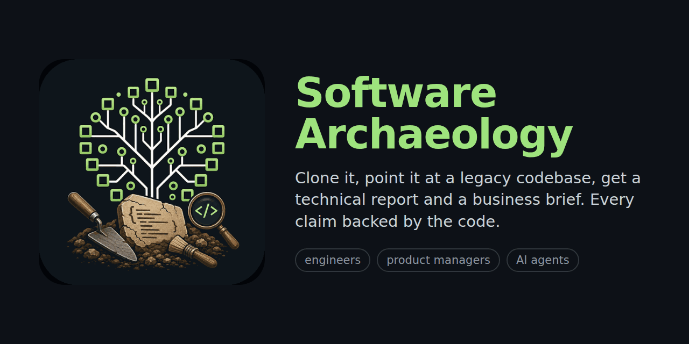
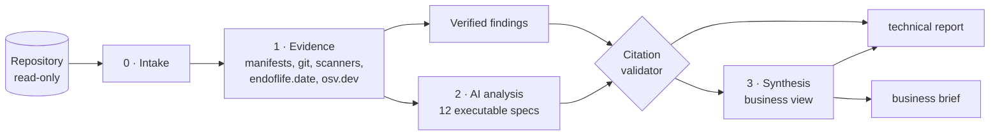

# Software Archaeology



Clone this repository, point it at a legacy codebase, and get two reports from the same analysis:

- **A business brief** for product managers, project managers and product engineers: status, what the system does,
  risks, the seven modernization options sized for this system, a roadmap, a FAQ and a glossary.
- **A technical report** for engineers: inventory, architecture diagram, dependencies and end-of-life dates, known
  vulnerabilities, hotspots, entry points, database rules, and every finding with the file and line that proves it.

Every statement in the business brief links to a finding in the technical report, and every finding links to the
code. AI is optional: without it you still get the verified facts; with it you get deeper findings, and a validator
rejects any AI claim whose citation does not match the code.

## Quick start

```bash
git clone https://github.com/camilokorea/software-archaeology
cd software-archaeology
./dig.sh /path/to/legacy-app
```

Open `archaeology-output/legacy-app/executive.html` (business) and `technical.html` (engineering).

`dig.sh` uses Docker when it is installed (the analyzed repository is mounted read-only, and the image includes
tokei and gitleaks); otherwise it creates a local Python environment (Python 3.10+).

### With AI analysis

```bash
export ANTHROPIC_API_KEY=…
./dig.sh /path/to/legacy-app --provider anthropic          # Claude (claude-opus-5-5 by default)
./dig.sh /path/to/legacy-app --provider ollama --model qwen2.5-coder:14b   # local model, code never leaves the machine
archaeology estimate /path/to/legacy-app --provider anthropic              # cost estimate first, no calls
archaeology dig /path/to/legacy-app --provider anthropic --dry-run         # see the exact prompts, no calls
```

The run stops before exceeding `budget.max_usd` (default 5 USD) and records model, prompt versions, tokens and cost in
`run.json`.

### With Claude Code or another agent

```text
/plugin marketplace add camilokorea/software-archaeology
/plugin install software-archaeology@software-archaeology
/software-archaeology:dig /path/to/legacy-app
```

Other agents (Copilot, Cursor, Codex…): follow [AGENTS.md](AGENTS.md). The agent does the reading; the CLI collects
the evidence and validates every citation.

## What you get

| File | For | What |
|---|---|---|
| `executive.html` / `.md` | product and project managers | status, capabilities, risk heat map, 7R options with week ranges and assumptions, roadmap, FAQ, glossary |
| `technical.html` / `.md` | engineers | inventory, C4-style container diagram, EOL table, hotspots, entry points, database, tests and delivery, all findings with evidence |
| `backlog.csv` | delivery | findings as tickets, importable into Jira or GitHub Issues |
| `architecture.mmd` | everyone | the container diagram in Mermaid |
| `findings/` · `synthesis.json` · `evidence/` | tools | the structured data behind the reports ([format](docs/FINDING_FORMAT.md)) |
| `run.json` | auditors | tool and prompt versions, model, tokens, cost, warnings |

## How it works



Details: [docs/HOW_IT_WORKS.md](docs/HOW_IT_WORKS.md) · how estimates are made: [docs/ESTIMATES.md](docs/ESTIMATES.md) ·
writing a spec: [docs/WRITING_SPECS.md](docs/WRITING_SPECS.md) · privacy: [PRIVACY.md](PRIVACY.md).

## The specs

Twelve executable specs in [`specs/`](specs/): inventory, dependencies, architecture, database, API, security,
testing, technical debt, DevOps, business capabilities, people and knowledge, and modernization risk. Each declares
the evidence it needs, which files to read, a checklist, evidence rules, how to translate into business language,
and what is out of scope. List them with `archaeology specs`.

## Configuration

`archaeology init` writes an `archaeology.yaml` with every option documented: scope (include/exclude), depth
(`quick`, `standard`, `deep`), provider and model, budget, privacy (redaction, `send_source: false`, pseudonymized
authors), network lookups and output. Incremental runs: `--since <git ref>` analyzes only what changed and reuses
earlier results; unchanged specs are always served from the cache.

## Supported stacks

Language-agnostic evidence (size, history, hotspots, secrets) works on any repository. Manifests, frameworks, entry
points and end-of-life dates are recognized for .NET Framework and .NET (packages.config, csproj, Web Forms, WCF,
MVC), Java (Maven, Gradle, Spring, Struts, Stripes, JAX-RS), JavaScript and TypeScript (npm, bower, AngularJS,
Angular, React, Vue, Express), Python (Django, Flask, FastAPI), PHP (Composer, Laravel), Go, Ruby, SQL and PL/SQL
scripts, and COBOL/CICS/JCL.

## Development

```bash
python3 -m venv .venv && .venv/bin/pip install -e ".[dev,anthropic]"
.venv/bin/pytest
```

The tests build a small synthetic legacy application and check the evidence scanners, the validator (it must reject
invented citations), redaction (secrets never reach a model or a report), budgets, caching, the agent hand-off and
both reports.

See [CONTRIBUTING.md](CONTRIBUTING.md) and [ROADMAP.md](ROADMAP.md). License: MIT.
