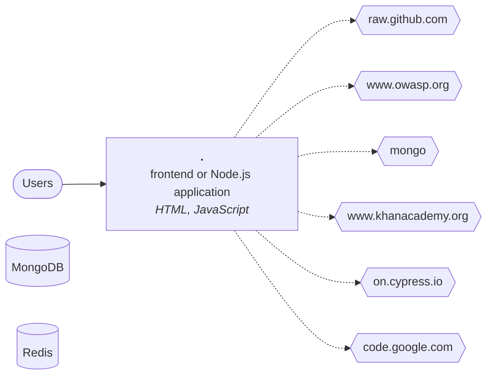

# Technical report: NodeGoat

Generated by Software Archaeology 2.0.0 on 2026-11-10 · commit `c5cb68a708` · analysis: deterministic tools only (no AI)

Every finding cites the code it is based on. ✅ marks facts produced by tools; 🤖 marks AI inferences that passed the citation check but deserve a second look.

## Summary

| Severity | Findings |
|---|---|
| 🔴 critical | 1 |
| 🟠 high | 5 |
| 🟡 medium | 5 |
| 🔵 low | 1 |

## Inventory

- **Size:** 5,012 lines of code in 94 files (small).
- **History:** 356 commits by 42 contributors, 2013-10-21 → 2023-06-21; bus factor 3.

| Language | Files | Lines of code |
|---|---:|---:|
| HTML | 24 | 2,644 |
| JavaScript | 44 | 2,368 |

**Frameworks and platforms**

- Express ^4.13.4 — [`package.json:13`](https://github.com/OWASP/NodeGoat/blob/c5cb68a7084e4ae7dcc60e6a98768720a81841e8/package.json#L13)

## Architecture (containers)

| Component | Kind | Languages | Manifests |
|---|---|---|---|
| `.` | frontend or Node.js application | HTML, JavaScript | `package.json` |

## Dependencies and end of life

36 declared dependencies, 0 runtime declarations.

## Hotspots (complexity × change frequency)

| File | Branches | Commits | Authors | Last change | Score |
|---|---:|---:|---:|---|---:|
| [`app/routes/session.js`](https://github.com/OWASP/NodeGoat/blob/c5cb68a7084e4ae7dcc60e6a98768720a81841e8/app/routes/session.js) | 31 | 26 | 6 | 2021-01-29 | 42.6 |
| [`server.js`](https://github.com/OWASP/NodeGoat/blob/c5cb68a7084e4ae7dcc60e6a98768720a81841e8/server.js) | 15 | 27 | 7 | 2023-03-17 | 21.4 |
| [`app/routes/profile.js`](https://github.com/OWASP/NodeGoat/blob/c5cb68a7084e4ae7dcc60e6a98768720a81841e8/app/routes/profile.js) | 12 | 21 | 7 | 2021-01-27 | 13.3 |
| [`app/data/profile-dao.js`](https://github.com/OWASP/NodeGoat/blob/c5cb68a7084e4ae7dcc60e6a98768720a81841e8/app/data/profile-dao.js) | 19 | 13 | 6 | 2020-01-29 | 13.1 |
| [`app/data/user-dao.js`](https://github.com/OWASP/NodeGoat/blob/c5cb68a7084e4ae7dcc60e6a98768720a81841e8/app/data/user-dao.js) | 12 | 19 | 10 | 2021-01-27 | 12.1 |
| [`app/data/allocations-dao.js`](https://github.com/OWASP/NodeGoat/blob/c5cb68a7084e4ae7dcc60e6a98768720a81841e8/app/data/allocations-dao.js) | 18 | 12 | 9 | 2021-01-27 | 11.4 |
| [`Gruntfile.js`](https://github.com/OWASP/NodeGoat/blob/c5cb68a7084e4ae7dcc60e6a98768720a81841e8/Gruntfile.js) | 10 | 19 | 7 | 2021-01-27 | 10.0 |
| [`test/security/profile-test.js`](https://github.com/OWASP/NodeGoat/blob/c5cb68a7084e4ae7dcc60e6a98768720a81841e8/test/security/profile-test.js) | 14 | 11 | 3 | 2021-01-29 | 8.1 |
| [`artifacts/db-reset.js`](https://github.com/OWASP/NodeGoat/blob/c5cb68a7084e4ae7dcc60e6a98768720a81841e8/artifacts/db-reset.js) | 11 | 11 | 7 | 2021-01-27 | 6.4 |
| [`app/data/contributions-dao.js`](https://github.com/OWASP/NodeGoat/blob/c5cb68a7084e4ae7dcc60e6a98768720a81841e8/app/data/contributions-dao.js) | 8 | 9 | 7 | 2020-01-26 | 3.8 |
| [`app/routes/contributions.js`](https://github.com/OWASP/NodeGoat/blob/c5cb68a7084e4ae7dcc60e6a98768720a81841e8/app/routes/contributions.js) | 6 | 12 | 5 | 2021-01-27 | 3.8 |
| [`app/routes/index.js`](https://github.com/OWASP/NodeGoat/blob/c5cb68a7084e4ae7dcc60e6a98768720a81841e8/app/routes/index.js) | 4 | 17 | 7 | 2023-05-27 | 3.6 |

## Entry points

Express: 22

| Framework | Method | Path | Where |
|---|---|---|---|
| Express | GET | `/` | [`app/routes/index.js:30`](https://github.com/OWASP/NodeGoat/blob/c5cb68a7084e4ae7dcc60e6a98768720a81841e8/app/routes/index.js#L30) |
| Express | GET | `/login` | [`app/routes/index.js:33`](https://github.com/OWASP/NodeGoat/blob/c5cb68a7084e4ae7dcc60e6a98768720a81841e8/app/routes/index.js#L33) |
| Express | POST | `/login` | [`app/routes/index.js:34`](https://github.com/OWASP/NodeGoat/blob/c5cb68a7084e4ae7dcc60e6a98768720a81841e8/app/routes/index.js#L34) |
| Express | GET | `/signup` | [`app/routes/index.js:37`](https://github.com/OWASP/NodeGoat/blob/c5cb68a7084e4ae7dcc60e6a98768720a81841e8/app/routes/index.js#L37) |
| Express | POST | `/signup` | [`app/routes/index.js:38`](https://github.com/OWASP/NodeGoat/blob/c5cb68a7084e4ae7dcc60e6a98768720a81841e8/app/routes/index.js#L38) |
| Express | GET | `/logout` | [`app/routes/index.js:41`](https://github.com/OWASP/NodeGoat/blob/c5cb68a7084e4ae7dcc60e6a98768720a81841e8/app/routes/index.js#L41) |
| Express | GET | `/dashboard` | [`app/routes/index.js:44`](https://github.com/OWASP/NodeGoat/blob/c5cb68a7084e4ae7dcc60e6a98768720a81841e8/app/routes/index.js#L44) |
| Express | GET | `/profile` | [`app/routes/index.js:47`](https://github.com/OWASP/NodeGoat/blob/c5cb68a7084e4ae7dcc60e6a98768720a81841e8/app/routes/index.js#L47) |
| Express | POST | `/profile` | [`app/routes/index.js:48`](https://github.com/OWASP/NodeGoat/blob/c5cb68a7084e4ae7dcc60e6a98768720a81841e8/app/routes/index.js#L48) |
| Express | GET | `/contributions` | [`app/routes/index.js:51`](https://github.com/OWASP/NodeGoat/blob/c5cb68a7084e4ae7dcc60e6a98768720a81841e8/app/routes/index.js#L51) |
| Express | POST | `/contributions` | [`app/routes/index.js:52`](https://github.com/OWASP/NodeGoat/blob/c5cb68a7084e4ae7dcc60e6a98768720a81841e8/app/routes/index.js#L52) |
| Express | GET | `/benefits` | [`app/routes/index.js:55`](https://github.com/OWASP/NodeGoat/blob/c5cb68a7084e4ae7dcc60e6a98768720a81841e8/app/routes/index.js#L55) |
| Express | POST | `/benefits` | [`app/routes/index.js:56`](https://github.com/OWASP/NodeGoat/blob/c5cb68a7084e4ae7dcc60e6a98768720a81841e8/app/routes/index.js#L56) |
| Express | GET | `/benefits` | [`app/routes/index.js:58`](https://github.com/OWASP/NodeGoat/blob/c5cb68a7084e4ae7dcc60e6a98768720a81841e8/app/routes/index.js#L58) |
| Express | POST | `/benefits` | [`app/routes/index.js:59`](https://github.com/OWASP/NodeGoat/blob/c5cb68a7084e4ae7dcc60e6a98768720a81841e8/app/routes/index.js#L59) |
| Express | GET | `/allocations/:userId` | [`app/routes/index.js:63`](https://github.com/OWASP/NodeGoat/blob/c5cb68a7084e4ae7dcc60e6a98768720a81841e8/app/routes/index.js#L63) |
| Express | GET | `/memos` | [`app/routes/index.js:66`](https://github.com/OWASP/NodeGoat/blob/c5cb68a7084e4ae7dcc60e6a98768720a81841e8/app/routes/index.js#L66) |
| Express | POST | `/memos` | [`app/routes/index.js:67`](https://github.com/OWASP/NodeGoat/blob/c5cb68a7084e4ae7dcc60e6a98768720a81841e8/app/routes/index.js#L67) |
| Express | GET | `/learn` | [`app/routes/index.js:70`](https://github.com/OWASP/NodeGoat/blob/c5cb68a7084e4ae7dcc60e6a98768720a81841e8/app/routes/index.js#L70) |
| Express | GET | `/research` | [`app/routes/index.js:76`](https://github.com/OWASP/NodeGoat/blob/c5cb68a7084e4ae7dcc60e6a98768720a81841e8/app/routes/index.js#L76) |
| Express | GET | `/` | [`app/routes/tutorial.js:8`](https://github.com/OWASP/NodeGoat/blob/c5cb68a7084e4ae7dcc60e6a98768720a81841e8/app/routes/tutorial.js#L8) |
| Express | GET | `/${page}` | [`app/routes/tutorial.js:31`](https://github.com/OWASP/NodeGoat/blob/c5cb68a7084e4ae7dcc60e6a98768720a81841e8/app/routes/tutorial.js#L31) |

## Database

- **Stores referenced:** MongoDB, Redis
- **Objects in SQL files:** none
- **ORM entities / mappers:** 0

## Tests and delivery

- **Tests:** 18 files, test/source ratio 0.58, frameworks: Mocha, Cypress, Selenium
- **CI:** GitHub Actions, Travis CI · **Containers:** 1 Dockerfile(s) · **IaC:** none · **Observability:** none

## Findings

### Security

#### SEC-001 · underscore 1.8.3 has 2 known vulnerabilities

**Severity:** 🔴 critical · **Confidence:** high · **Effort:** S · ✅ verified by tools

**What it means technically.** OSV lists GHSA-cf4h-3jhx-xvhq, GHSA-qpx9-hpmf-5gmw for this exact version. Arbitrary Code Execution in underscore; Underscore has unlimited recursion in _.flatten and _.isEqual, potential for DoS attack

**What it means for the business.** underscore 1.8.3, a library the system depends on, has publicly known security flaws. Attackers read these lists too.

**Recommendation.** Upgrade underscore to a version without these advisories and re-test the features that use it.

**Evidence**

- [`package.json:23`](https://github.com/OWASP/NodeGoat/blob/c5cb68a7084e4ae7dcc60e6a98768720a81841e8/package.json#L23) — osv.dev

**References:** <https://osv.dev/vulnerability/GHSA-cf4h-3jhx-xvhq>, <https://osv.dev/vulnerability/GHSA-qpx9-hpmf-5gmw>

#### SEC-002 · Hard-coded password, secret or API key found in 3 file(s)

**Severity:** 🟠 high · **Confidence:** high · **Effort:** S · ✅ verified by tools

**What it means technically.** Credentials are committed to the source tree. Anyone with read access to the repository, its history or a backup can use them.

**What it means for the business.** Passwords or keys are written inside the code. Whoever gets a copy of the code gets access to the systems those keys open.

**Recommendation.** Rotate these credentials now, move them to a secrets store (environment, vault), and purge them from the git history.

**Evidence**

- [`app/views/tutorial/a2.html:153`](https://github.com/OWASP/NodeGoat/blob/c5cb68a7084e4ae7dcc60e6a98768720a81841e8/app/views/tutorial/a2.html#L153) — `secret: "[REDACTED-SECRET]",`
- [`app/views/tutorial/a3.html:176`](https://github.com/OWASP/NodeGoat/blob/c5cb68a7084e4ae7dcc60e6a98768720a81841e8/app/views/tutorial/a3.html#L176) — `secret: "[REDACTED-SECRET]",`
- [`artifacts/db-reset.js:18`](https://github.com/OWASP/NodeGoat/blob/c5cb68a7084e4ae7dcc60e6a98768720a81841e8/artifacts/db-reset.js#L18) — `"password": "[REDACTED-SECRET]",`
- [`artifacts/db-reset.js:19`](https://github.com/OWASP/NodeGoat/blob/c5cb68a7084e4ae7dcc60e6a98768720a81841e8/artifacts/db-reset.js#L19) — `//"password" : "[REDACTED-SECRET]", // [REDACTED-SECRET]`
- [`artifacts/db-reset.js:27`](https://github.com/OWASP/NodeGoat/blob/c5cb68a7084e4ae7dcc60e6a98768720a81841e8/artifacts/db-reset.js#L27) — `"password": "[REDACTED-SECRET]"`
- [`artifacts/db-reset.js:28`](https://github.com/OWASP/NodeGoat/blob/c5cb68a7084e4ae7dcc60e6a98768720a81841e8/artifacts/db-reset.js#L28) — `// "password" : "[REDACTED-SECRET]",// [REDACTED-SECRET]`
- [`artifacts/db-reset.js:35`](https://github.com/OWASP/NodeGoat/blob/c5cb68a7084e4ae7dcc60e6a98768720a81841e8/artifacts/db-reset.js#L35) — `"password": "[REDACTED-SECRET]"`
- [`artifacts/db-reset.js:36`](https://github.com/OWASP/NodeGoat/blob/c5cb68a7084e4ae7dcc60e6a98768720a81841e8/artifacts/db-reset.js#L36) — `//"password" : "[REDACTED-SECRET]", // [REDACTED-SECRET]`

**References:** CWE-798, OWASP A07:2021

#### SEC-003 · body-parser 1.15.1 has 3 known vulnerabilities

**Severity:** 🟠 high · **Confidence:** high · **Effort:** M · ✅ verified by tools

**What it means technically.** OSV lists GHSA-27r3-jxmh-p828, GHSA-qwcr-r2fm-qrc7, GHSA-v422-hmwv-36x6 for this exact version. body-parser vulnerable to Denial of Service via trailing bytes after a compressed request body; body-parser vulnerable to denial of service when url encoding is enabled

**What it means for the business.** body-parser 1.15.1, a library the system depends on, has publicly known security flaws. Attackers read these lists too.

**Recommendation.** Upgrade body-parser to a version without these advisories and re-test the features that use it.

**Evidence**

- [`package.json:9`](https://github.com/OWASP/NodeGoat/blob/c5cb68a7084e4ae7dcc60e6a98768720a81841e8/package.json#L9) — osv.dev

**References:** <https://osv.dev/vulnerability/GHSA-27r3-jxmh-p828>, <https://osv.dev/vulnerability/GHSA-qwcr-r2fm-qrc7>, <https://osv.dev/vulnerability/GHSA-v422-hmwv-36x6>

#### SEC-004 · marked 0.3.5 has 6 known vulnerabilities

**Severity:** 🟠 high · **Confidence:** high · **Effort:** M · ✅ verified by tools

**What it means technically.** OSV lists GHSA-5v2h-r2cx-5xgj, GHSA-7px7-7xjx-hxm8, GHSA-p9wx-2529-fp83, GHSA-rrrm-qjm4-v8hf, GHSA-vfvf-mqq8-rwqc, GHSA-x5pg-88wf-qq4p for this exact version. Inefficient Regular Expression Complexity in marked; Marked vulnerable to XSS from data URIs

**What it means for the business.** marked 0.3.5, a library the system depends on, has publicly known security flaws. Attackers read these lists too.

**Recommendation.** Upgrade marked to a version without these advisories and re-test the features that use it.

**Evidence**

- [`package.json:17`](https://github.com/OWASP/NodeGoat/blob/c5cb68a7084e4ae7dcc60e6a98768720a81841e8/package.json#L17) — osv.dev

**References:** <https://osv.dev/vulnerability/GHSA-5v2h-r2cx-5xgj>, <https://osv.dev/vulnerability/GHSA-7px7-7xjx-hxm8>, <https://osv.dev/vulnerability/GHSA-p9wx-2529-fp83>, <https://osv.dev/vulnerability/GHSA-rrrm-qjm4-v8hf>, <https://osv.dev/vulnerability/GHSA-vfvf-mqq8-rwqc>

#### SEC-005 · mongodb 2.1.18 has 1 known vulnerability

**Severity:** 🟠 high · **Confidence:** high · **Effort:** S · ✅ verified by tools

**What it means technically.** OSV lists GHSA-mh5c-679w-hh4r for this exact version. Denial of Service in mongodb

**What it means for the business.** mongodb 2.1.18, a library the system depends on, has publicly known security flaws. Attackers read these lists too.

**Recommendation.** Upgrade mongodb to a version without these advisories and re-test the features that use it.

**Evidence**

- [`package.json:18`](https://github.com/OWASP/NodeGoat/blob/c5cb68a7084e4ae7dcc60e6a98768720a81841e8/package.json#L18) — osv.dev

**References:** <https://osv.dev/vulnerability/GHSA-mh5c-679w-hh4r>

#### SEC-006 · swig 1.4.2 has 1 known vulnerability

**Severity:** 🟠 high · **Confidence:** high · **Effort:** S · ✅ verified by tools

**What it means technically.** OSV lists GHSA-2rq5-699j-x7p6 for this exact version. Arbitrary local file read vulnerability during template rendering

**What it means for the business.** swig 1.4.2, a library the system depends on, has publicly known security flaws. Attackers read these lists too.

**Recommendation.** Upgrade swig to a version without these advisories and re-test the features that use it.

**Evidence**

- [`package.json:22`](https://github.com/OWASP/NodeGoat/blob/c5cb68a7084e4ae7dcc60e6a98768720a81841e8/package.json#L22) — osv.dev

**References:** <https://osv.dev/vulnerability/GHSA-2rq5-699j-x7p6>

#### SEC-007 · async 2.0.0 has 1 known vulnerability (development dependency)

**Severity:** 🟡 medium · **Confidence:** high · **Effort:** S · ✅ verified by tools

**What it means technically.** OSV lists GHSA-fwr7-v2mv-hh25 for this exact version. Prototype Pollution in async

**What it means for the business.** async 2.0.0, a tool used to build or test the system, has publicly known security flaws. It does not run in production, but it can affect developers' machines and the build.

**Recommendation.** Upgrade async to a version without these advisories and re-test the features that use it.

**Evidence**

- [`package.json:42`](https://github.com/OWASP/NodeGoat/blob/c5cb68a7084e4ae7dcc60e6a98768720a81841e8/package.json#L42) — osv.dev

**References:** <https://osv.dev/vulnerability/GHSA-fwr7-v2mv-hh25>

#### SEC-008 · express 4.13.4 has 2 known vulnerabilities

**Severity:** 🟡 medium · **Confidence:** high · **Effort:** S · ✅ verified by tools

**What it means technically.** OSV lists GHSA-qw6h-vgh9-j6wx, GHSA-rv95-896h-c2vc for this exact version. express vulnerable to XSS via response.redirect(); Express.js Open Redirect in malformed URLs

**What it means for the business.** express 4.13.4, a library the system depends on, has publicly known security flaws. Attackers read these lists too.

**Recommendation.** Upgrade express to a version without these advisories and re-test the features that use it.

**Evidence**

- [`package.json:13`](https://github.com/OWASP/NodeGoat/blob/c5cb68a7084e4ae7dcc60e6a98768720a81841e8/package.json#L13) — osv.dev

**References:** <https://osv.dev/vulnerability/GHSA-qw6h-vgh9-j6wx>, <https://osv.dev/vulnerability/GHSA-rv95-896h-c2vc>

#### SEC-009 · grunt 1.0.3 has 3 known vulnerabilities (development dependency)

**Severity:** 🟡 medium · **Confidence:** high · **Effort:** M · ✅ verified by tools

**What it means technically.** OSV lists GHSA-j383-35pm-c5h4, GHSA-m5pj-vjjf-4m3h, GHSA-rm36-94g8-835r for this exact version. Path Traversal in Grunt; Arbitrary Code Execution in grunt

**What it means for the business.** grunt 1.0.3, a tool used to build or test the system, has publicly known security flaws. It does not run in production, but it can affect developers' machines and the build.

**Recommendation.** Upgrade grunt to a version without these advisories and re-test the features that use it.

**Evidence**

- [`package.json:45`](https://github.com/OWASP/NodeGoat/blob/c5cb68a7084e4ae7dcc60e6a98768720a81841e8/package.json#L45) — osv.dev

**References:** <https://osv.dev/vulnerability/GHSA-j383-35pm-c5h4>, <https://osv.dev/vulnerability/GHSA-m5pj-vjjf-4m3h>, <https://osv.dev/vulnerability/GHSA-rm36-94g8-835r>

### Technical debt

#### DEBT-001 · 8 complex files change far more often than the rest

**Severity:** 🟡 medium · **Confidence:** high · **Effort:** L · ✅ verified by tools

**What it means technically.** These files combine high branching with frequent edits: the places where defects and merge conflicts concentrate.

**What it means for the business.** A small set of files absorbs most of the changes and most of the risk. Every new feature that touches them costs more and breaks more often.

**Recommendation.** Cover these files with tests first, then split them along their responsibilities before any larger migration.

**Evidence**

- [`app/routes/session.js`](https://github.com/OWASP/NodeGoat/blob/c5cb68a7084e4ae7dcc60e6a98768720a81841e8/app/routes/session.js) — hotspot: 31 branches, 26 commits
- [`server.js`](https://github.com/OWASP/NodeGoat/blob/c5cb68a7084e4ae7dcc60e6a98768720a81841e8/server.js) — hotspot: 15 branches, 27 commits
- [`app/routes/profile.js`](https://github.com/OWASP/NodeGoat/blob/c5cb68a7084e4ae7dcc60e6a98768720a81841e8/app/routes/profile.js) — hotspot: 12 branches, 21 commits
- [`app/data/profile-dao.js`](https://github.com/OWASP/NodeGoat/blob/c5cb68a7084e4ae7dcc60e6a98768720a81841e8/app/data/profile-dao.js) — hotspot: 19 branches, 13 commits
- [`app/data/user-dao.js`](https://github.com/OWASP/NodeGoat/blob/c5cb68a7084e4ae7dcc60e6a98768720a81841e8/app/data/user-dao.js) — hotspot: 12 branches, 19 commits
- [`app/data/allocations-dao.js`](https://github.com/OWASP/NodeGoat/blob/c5cb68a7084e4ae7dcc60e6a98768720a81841e8/app/data/allocations-dao.js) — hotspot: 18 branches, 12 commits
- [`Gruntfile.js`](https://github.com/OWASP/NodeGoat/blob/c5cb68a7084e4ae7dcc60e6a98768720a81841e8/Gruntfile.js) — hotspot: 10 branches, 19 commits
- [`test/security/profile-test.js`](https://github.com/OWASP/NodeGoat/blob/c5cb68a7084e4ae7dcc60e6a98768720a81841e8/test/security/profile-test.js) — hotspot: 14 branches, 11 commits

### Build, deploy and operations

#### OPS-001 · No logging or monitoring library detected

**Severity:** 🔵 low · **Confidence:** high · **Effort:** S · ✅ verified by tools

**What it means technically.** No known logging, tracing or metrics library is declared in the manifests or configuration.

**What it means for the business.** When something fails in production it is hard to know what happened or how often.

**Recommendation.** Add structured logging and basic health metrics before any migration, to compare before and after.

**Evidence**

- [`package.json`](https://github.com/OWASP/NodeGoat/blob/c5cb68a7084e4ae7dcc60e6a98768720a81841e8/package.json) — inventory

### Risk

#### RSK-001 · No changes since 2023-06-21

**Severity:** 🟡 medium · **Confidence:** high · **Effort:** M · ✅ verified by tools

**What it means technically.** The last commit is more than two years old; the build tools and dependencies have likely drifted.

**What it means for the business.** Nobody has changed this system in years. Even small fixes will first need someone to make it build and run again.

**Recommendation.** Before planning changes, prove the system still builds and runs in a clean environment.

**Evidence**

- `.` — git history

