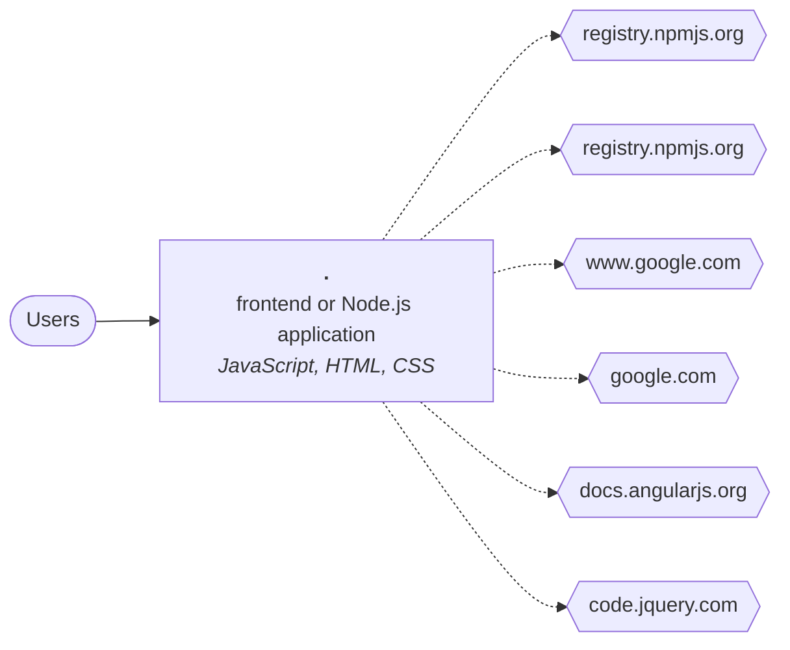

# Technical report: angular-phonecat

Generated by Software Archaeology 2.0.0 on 2026-11-10 · commit `ef6f6eb672` · analysis: deterministic tools only (no AI)

Every finding cites the code it is based on. ✅ marks facts produced by tools; 🤖 marks AI inferences that passed the citation check but deserve a second look.

## Summary

| Severity | Findings |
|---|---|
| 🔴 critical | 1 |
| 🟠 high | 2 |
| 🟡 medium | 4 |
| 🔵 low | 3 |

## Inventory

- **Size:** 852 lines of code in 145 files (small).
- **History:** 238 commits by 44 contributors, 2010-12-24 → 2020-06-05; bus factor 2.

| Language | Files | Lines of code |
|---|---:|---:|
| JavaScript | 19 | 416 |
| HTML | 3 | 175 |
| CSS | 2 | 136 |
| Shell | 9 | 114 |
| Batch | 1 | 11 |

**Frameworks and platforms**

- AngularJS 1.x 1.8.x — [`package.json:9`](https://github.com/angular/angular-phonecat/blob/ef6f6eb672ded472b4e442d598f5df40d0e0642c/package.json#L9)
- Bootstrap 3.3.x — [`package.json:13`](https://github.com/angular/angular-phonecat/blob/ef6f6eb672ded472b4e442d598f5df40d0e0642c/package.json#L13)
- jQuery 3.3.x — [`package.json:14`](https://github.com/angular/angular-phonecat/blob/ef6f6eb672ded472b4e442d598f5df40d0e0642c/package.json#L14)

## Architecture (containers)

| Component | Kind | Languages | Manifests |
|---|---|---|---|
| `.` | frontend or Node.js application | JavaScript, HTML, CSS, Shell | `package.json` |

## Dependencies and end of life

15 declared dependencies, 0 runtime declarations.

| Technology | Version | Cycle | End of life | Status | Declared in |
|---|---|---|---|---|---|
| AngularJS | 1.8 | 1.8 | 2021-12-31 | ⛔ past EOL | [`package.json:9`](https://github.com/angular/angular-phonecat/blob/ef6f6eb672ded472b4e442d598f5df40d0e0642c/package.json#L9) |
| Bootstrap | 3.3 | 3 | 2019-07-24 | ⛔ past EOL | [`package.json:13`](https://github.com/angular/angular-phonecat/blob/ef6f6eb672ded472b4e442d598f5df40d0e0642c/package.json#L13) |
| jQuery | 3.3 | 3 | False | supported | [`package.json:14`](https://github.com/angular/angular-phonecat/blob/ef6f6eb672ded472b4e442d598f5df40d0e0642c/package.json#L14) |

## Hotspots (complexity × change frequency)

| File | Branches | Commits | Authors | Last change | Score |
|---|---:|---:|---:|---|---:|
| [`e2e-tests/scenarios.js`](https://github.com/angular/angular-phonecat/blob/ef6f6eb672ded472b4e442d598f5df40d0e0642c/e2e-tests/scenarios.js) | 1 | 10 | 4 | 2020-06-05 | 8.1 |
| [`app/app.animations.js`](https://github.com/angular/angular-phonecat/blob/ef6f6eb672ded472b4e442d598f5df40d0e0642c/app/app.animations.js) | 4 | 1 | 1 | 2020-06-05 | 3.2 |
| [`app/phone-list/phone-list.component.spec.js`](https://github.com/angular/angular-phonecat/blob/ef6f6eb672ded472b4e442d598f5df40d0e0642c/app/phone-list/phone-list.component.spec.js) | 1 | 3 | 1 | 2020-06-05 | 2.4 |
| [`app/app.config.js`](https://github.com/angular/angular-phonecat/blob/ef6f6eb672ded472b4e442d598f5df40d0e0642c/app/app.config.js) | 2 | 1 | 1 | 2020-06-05 | 1.6 |
| [`app/core/checkmark/checkmark.filter.js`](https://github.com/angular/angular-phonecat/blob/ef6f6eb672ded472b4e442d598f5df40d0e0642c/app/core/checkmark/checkmark.filter.js) | 1 | 1 | 1 | 2020-06-05 | 0.8 |

## Tests and delivery

- **Tests:** 4 files, test/source ratio 0.25, frameworks: Jasmine, Karma, Protractor
- **CI:** Travis CI · **Containers:** 0 Dockerfile(s) · **IaC:** none · **Observability:** none

## Findings

### Dependencies

#### DEP-001 · AngularJS 1.8 is past its end of life (2021-12-31)

**Severity:** 🔴 critical · **Confidence:** high · **Effort:** L · ✅ verified by tools

**What it means technically.** Release cycle 1.8 of angularjs gets no security or bug fixes since 2021-12-31. The newest cycle is 1.8.

**What it means for the business.** Part of the system runs on AngularJS 1.8, which its maker stopped fixing on 2021-12-31. New security holes will stay open, and auditors and insurers usually flag this.

**Recommendation.** Plan an upgrade of AngularJS to a supported release (1.8 or another supported cycle).

**Evidence**

- [`package.json:9`](https://github.com/angular/angular-phonecat/blob/ef6f6eb672ded472b4e442d598f5df40d0e0642c/package.json#L9) — endoflife.date

**References:** <https://endoflife.date/angularjs>

#### DEP-002 · Bootstrap 3.3 is past its end of life (2019-07-24)

**Severity:** 🟠 high · **Confidence:** high · **Effort:** L · ✅ verified by tools

**What it means technically.** Release cycle 3 of bootstrap gets no security or bug fixes since 2019-07-24. The newest cycle is 5.

**What it means for the business.** Part of the system runs on Bootstrap 3.3, which its maker stopped fixing on 2019-07-24. New security holes will stay open, and auditors and insurers usually flag this.

**Recommendation.** Plan an upgrade of Bootstrap to a supported release (5 or another supported cycle).

**Evidence**

- [`package.json:13`](https://github.com/angular/angular-phonecat/blob/ef6f6eb672ded472b4e442d598f5df40d0e0642c/package.json#L13) — endoflife.date

**References:** <https://endoflife.date/bootstrap>

### Security

#### SEC-001 · angular 1.8 has 10 known vulnerabilities

**Severity:** 🟠 high · **Confidence:** high · **Effort:** M · ✅ verified by tools

**What it means technically.** OSV lists GHSA-2qqx-w9hr-q5gx, GHSA-2vrf-hf26-jrp5, GHSA-4w4v-5hc9-xrr2, GHSA-7x27-g8rg-x87w, GHSA-j58c-ww9w-pwp5, GHSA-m2h2-264f-f486… for this exact version. angular vulnerable to regular expression denial of service via the $resource service; angular vulnerable to regular expression denial of service via the angular.copy() utility

**What it means for the business.** angular 1.8, a library the system depends on, has publicly known security flaws. Attackers read these lists too.

**Recommendation.** Upgrade angular to a version without these advisories and re-test the features that use it.

**Evidence**

- [`package.json:9`](https://github.com/angular/angular-phonecat/blob/ef6f6eb672ded472b4e442d598f5df40d0e0642c/package.json#L9) — osv.dev

**References:** <https://osv.dev/vulnerability/GHSA-2qqx-w9hr-q5gx>, <https://osv.dev/vulnerability/GHSA-2vrf-hf26-jrp5>, <https://osv.dev/vulnerability/GHSA-4w4v-5hc9-xrr2>, <https://osv.dev/vulnerability/GHSA-7x27-g8rg-x87w>, <https://osv.dev/vulnerability/GHSA-j58c-ww9w-pwp5>

#### SEC-002 · bootstrap 3.3 has 7 known vulnerabilities

**Severity:** 🟡 medium · **Confidence:** high · **Effort:** M · ✅ verified by tools

**What it means technically.** OSV lists GHSA-3mgp-fx93-9xv5, GHSA-3wqf-4x89-9g79, GHSA-4p24-vmcr-4gqj, GHSA-7mvr-5x2g-wfc8, GHSA-9v3m-8fp8-mj99, GHSA-ph58-4vrj-w6hr… for this exact version. XSS vulnerability that affects bootstrap; Bootstrap vulnerable to Cross-Site Scripting (XSS)

**What it means for the business.** bootstrap 3.3, a library the system depends on, has publicly known security flaws. Attackers read these lists too.

**Recommendation.** Upgrade bootstrap to a version without these advisories and re-test the features that use it.

**Evidence**

- [`package.json:13`](https://github.com/angular/angular-phonecat/blob/ef6f6eb672ded472b4e442d598f5df40d0e0642c/package.json#L13) — osv.dev

**References:** <https://osv.dev/vulnerability/GHSA-3mgp-fx93-9xv5>, <https://osv.dev/vulnerability/GHSA-3wqf-4x89-9g79>, <https://osv.dev/vulnerability/GHSA-4p24-vmcr-4gqj>, <https://osv.dev/vulnerability/GHSA-7mvr-5x2g-wfc8>, <https://osv.dev/vulnerability/GHSA-9v3m-8fp8-mj99>

#### SEC-003 · jquery 3.3 has 3 known vulnerabilities

**Severity:** 🟡 medium · **Confidence:** high · **Effort:** M · ✅ verified by tools

**What it means technically.** OSV lists GHSA-6c3j-c64m-qhgq, GHSA-gxr4-xjj5-5px2, GHSA-jpcq-cgw6-v4j6 for this exact version. XSS in jQuery as used in Drupal, Backdrop CMS, and other products; Potential XSS vulnerability in jQuery

**What it means for the business.** jquery 3.3, a library the system depends on, has publicly known security flaws. Attackers read these lists too.

**Recommendation.** Upgrade jquery to a version without these advisories and re-test the features that use it.

**Evidence**

- [`package.json:14`](https://github.com/angular/angular-phonecat/blob/ef6f6eb672ded472b4e442d598f5df40d0e0642c/package.json#L14) — osv.dev

**References:** <https://osv.dev/vulnerability/GHSA-6c3j-c64m-qhgq>, <https://osv.dev/vulnerability/GHSA-gxr4-xjj5-5px2>, <https://osv.dev/vulnerability/GHSA-jpcq-cgw6-v4j6>

#### SEC-004 · karma 3.1.4 has 2 known vulnerabilities (development dependency)

**Severity:** 🔵 low · **Confidence:** high · **Effort:** S · ✅ verified by tools

**What it means technically.** OSV lists GHSA-7x7c-qm48-pq9c, GHSA-rc3x-jf5g-xvc5 for this exact version. Cross-site Scripting in karma; Open redirect in karma

**What it means for the business.** karma 3.1.4, a tool used to build or test the system, has publicly known security flaws. It does not run in production, but it can affect developers' machines and the build.

**Recommendation.** Upgrade karma to a version without these advisories and re-test the features that use it.

**Evidence**

- [`package.json:21`](https://github.com/angular/angular-phonecat/blob/ef6f6eb672ded472b4e442d598f5df40d0e0642c/package.json#L21) — osv.dev

**References:** <https://osv.dev/vulnerability/GHSA-7x7c-qm48-pq9c>, <https://osv.dev/vulnerability/GHSA-rc3x-jf5g-xvc5>

### Technical debt

#### DEBT-001 · 5 complex files change far more often than the rest

**Severity:** 🟡 medium · **Confidence:** high · **Effort:** L · ✅ verified by tools

**What it means technically.** These files combine high branching with frequent edits: the places where defects and merge conflicts concentrate.

**What it means for the business.** A small set of files absorbs most of the changes and most of the risk. Every new feature that touches them costs more and breaks more often.

**Recommendation.** Cover these files with tests first, then split them along their responsibilities before any larger migration.

**Evidence**

- [`e2e-tests/scenarios.js`](https://github.com/angular/angular-phonecat/blob/ef6f6eb672ded472b4e442d598f5df40d0e0642c/e2e-tests/scenarios.js) — hotspot: 1 branches, 10 commits
- [`app/app.animations.js`](https://github.com/angular/angular-phonecat/blob/ef6f6eb672ded472b4e442d598f5df40d0e0642c/app/app.animations.js) — hotspot: 4 branches, 1 commits
- [`app/phone-list/phone-list.component.spec.js`](https://github.com/angular/angular-phonecat/blob/ef6f6eb672ded472b4e442d598f5df40d0e0642c/app/phone-list/phone-list.component.spec.js) — hotspot: 1 branches, 3 commits
- [`app/app.config.js`](https://github.com/angular/angular-phonecat/blob/ef6f6eb672ded472b4e442d598f5df40d0e0642c/app/app.config.js) — hotspot: 2 branches, 1 commits
- [`app/core/checkmark/checkmark.filter.js`](https://github.com/angular/angular-phonecat/blob/ef6f6eb672ded472b4e442d598f5df40d0e0642c/app/core/checkmark/checkmark.filter.js) — hotspot: 1 branches, 1 commits

### Build, deploy and operations

#### OPS-001 · No container or infrastructure-as-code definitions

**Severity:** 🔵 low · **Confidence:** high · **Effort:** M · ✅ verified by tools

**What it means technically.** The runtime environment is not described in code, so it cannot be recreated automatically.

**What it means for the business.** Setting up a new server or a test environment is manual work that only a few people know how to do.

**Recommendation.** Describe the runtime in a Dockerfile or IaC as a first, low-risk modernization step.

**Evidence**

- [`package.json`](https://github.com/angular/angular-phonecat/blob/ef6f6eb672ded472b4e442d598f5df40d0e0642c/package.json) — inventory

#### OPS-002 · No logging or monitoring library detected

**Severity:** 🔵 low · **Confidence:** high · **Effort:** S · ✅ verified by tools

**What it means technically.** No known logging, tracing or metrics library is declared in the manifests or configuration.

**What it means for the business.** When something fails in production it is hard to know what happened or how often.

**Recommendation.** Add structured logging and basic health metrics before any migration, to compare before and after.

**Evidence**

- [`package.json`](https://github.com/angular/angular-phonecat/blob/ef6f6eb672ded472b4e442d598f5df40d0e0642c/package.json) — inventory

### Risk

#### RSK-001 · No changes since 2020-06-05

**Severity:** 🟡 medium · **Confidence:** high · **Effort:** M · ✅ verified by tools

**What it means technically.** The last commit is more than two years old; the build tools and dependencies have likely drifted.

**What it means for the business.** Nobody has changed this system in years. Even small fixes will first need someone to make it build and run again.

**Recommendation.** Before planning changes, prove the system still builds and runs in a clean environment.

**Evidence**

- `.` — git history

