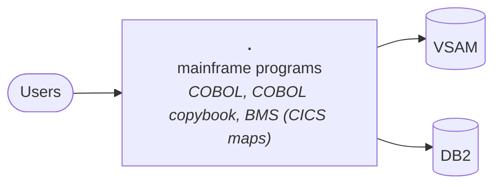

# Technical report: carddemo

Generated by Software Archaeology 2.0.0 on 2026-11-10 · commit `59cc6c2fd7` · analysis: deterministic tools only (no AI)

Every finding cites the code it is based on. ✅ marks facts produced by tools; 🤖 marks AI inferences that passed the citation check but deserve a second look.

## Summary

| Severity | Findings |
|---|---|
| 🟠 high | 2 |
| 🟡 medium | 2 |
| 🔵 low | 3 |

## Inventory

- **Size:** 47,643 lines of code in 328 files (medium).
- **History:** 26 commits by 7 contributors, 2022-08-22 → 2025-10-16; bus factor 2.

| Language | Files | Lines of code |
|---|---:|---:|
| COBOL | 44 | 27,542 |
| COBOL copybook | 62 | 10,578 |
| BMS (CICS maps) | 21 | 5,754 |
| JCL | 55 | 3,366 |
| Shell | 9 | 289 |
| Assembler | 2 | 114 |

**Frameworks and platforms**

- CICS — [`app/app-authorization-ims-db2-mq/cbl/COPAUA0C.cbl:226`](https://github.com/aws-samples/aws-mainframe-modernization-carddemo/blob/59cc6c2fd7ebd7ef7925cad552a01a4b8b6e4d5e/app/app-authorization-ims-db2-mq/cbl/COPAUA0C.cbl#L226)
- COBOL — [`app/app-authorization-ims-db2-mq/cbl/CBPAUP0C.cbl`](https://github.com/aws-samples/aws-mainframe-modernization-carddemo/blob/59cc6c2fd7ebd7ef7925cad552a01a4b8b6e4d5e/app/app-authorization-ims-db2-mq/cbl/CBPAUP0C.cbl)
- JCL batch — [`app/app-authorization-ims-db2-mq/jcl/CBPAUP0J.jcl`](https://github.com/aws-samples/aws-mainframe-modernization-carddemo/blob/59cc6c2fd7ebd7ef7925cad552a01a4b8b6e4d5e/app/app-authorization-ims-db2-mq/jcl/CBPAUP0J.jcl)

## Architecture (containers)

| Component | Kind | Languages | Manifests |
|---|---|---|---|
| `.` | mainframe programs | COBOL, COBOL copybook, BMS (CICS maps), JCL |  |

## Dependencies and end of life

0 declared dependencies, 0 runtime declarations.

## Hotspots (complexity × change frequency)

| File | Branches | Commits | Authors | Last change | Score |
|---|---:|---:|---:|---|---:|
| [`app/cbl/COACTUPC.cbl`](https://github.com/aws-samples/aws-mainframe-modernization-carddemo/blob/59cc6c2fd7ebd7ef7925cad552a01a4b8b6e4d5e/app/cbl/COACTUPC.cbl) | 618 | 3 | 3 | 2025-08-03 | 30.0 |
| [`app/app-transaction-type-db2/cbl/COTRTLIC.cbl`](https://github.com/aws-samples/aws-mainframe-modernization-carddemo/blob/59cc6c2fd7ebd7ef7925cad552a01a4b8b6e4d5e/app/app-transaction-type-db2/cbl/COTRTLIC.cbl) | 356 | 1 | 1 | 2025-08-03 | 5.8 |
| [`app/cbl/CBTRN01C.cbl`](https://github.com/aws-samples/aws-mainframe-modernization-carddemo/blob/59cc6c2fd7ebd7ef7925cad552a01a4b8b6e4d5e/app/cbl/CBTRN01C.cbl) | 113 | 3 | 3 | 2025-08-03 | 5.5 |
| [`app/cbl/CBTRN02C.cbl`](https://github.com/aws-samples/aws-mainframe-modernization-carddemo/blob/59cc6c2fd7ebd7ef7925cad552a01a4b8b6e4d5e/app/cbl/CBTRN02C.cbl) | 162 | 2 | 2 | 2025-08-03 | 5.2 |
| [`app/cbl/CBTRN03C.cbl`](https://github.com/aws-samples/aws-mainframe-modernization-carddemo/blob/59cc6c2fd7ebd7ef7925cad552a01a4b8b6e4d5e/app/cbl/CBTRN03C.cbl) | 161 | 2 | 2 | 2025-08-03 | 5.2 |
| [`app/app-transaction-type-db2/cbl/COTRTUPC.cbl`](https://github.com/aws-samples/aws-mainframe-modernization-carddemo/blob/59cc6c2fd7ebd7ef7925cad552a01a4b8b6e4d5e/app/app-transaction-type-db2/cbl/COTRTUPC.cbl) | 294 | 1 | 1 | 2025-08-03 | 4.8 |
| [`app/cbl/CBACT04C.cbl`](https://github.com/aws-samples/aws-mainframe-modernization-carddemo/blob/59cc6c2fd7ebd7ef7925cad552a01a4b8b6e4d5e/app/cbl/CBACT04C.cbl) | 147 | 2 | 2 | 2025-08-03 | 4.8 |
| [`app/cbl/COCRDUPC.cbl`](https://github.com/aws-samples/aws-mainframe-modernization-carddemo/blob/59cc6c2fd7ebd7ef7925cad552a01a4b8b6e4d5e/app/cbl/COCRDUPC.cbl) | 278 | 1 | 1 | 2022-09-01 | 4.5 |
| [`app/cbl/COCRDLIC.cbl`](https://github.com/aws-samples/aws-mainframe-modernization-carddemo/blob/59cc6c2fd7ebd7ef7925cad552a01a4b8b6e4d5e/app/cbl/COCRDLIC.cbl) | 236 | 1 | 1 | 2022-09-01 | 3.8 |
| [`app/cbl/CBSTM03A.CBL`](https://github.com/aws-samples/aws-mainframe-modernization-carddemo/blob/59cc6c2fd7ebd7ef7925cad552a01a4b8b6e4d5e/app/cbl/CBSTM03A.CBL) | 92 | 2 | 2 | 2025-08-03 | 3.0 |
| [`app/cbl/COTRN02C.cbl`](https://github.com/aws-samples/aws-mainframe-modernization-carddemo/blob/59cc6c2fd7ebd7ef7925cad552a01a4b8b6e4d5e/app/cbl/COTRN02C.cbl) | 181 | 1 | 1 | 2022-09-01 | 2.9 |
| [`app/app-authorization-ims-db2-mq/cbl/COPAUS0C.cbl`](https://github.com/aws-samples/aws-mainframe-modernization-carddemo/blob/59cc6c2fd7ebd7ef7925cad552a01a4b8b6e4d5e/app/app-authorization-ims-db2-mq/cbl/COPAUS0C.cbl) | 176 | 1 | 1 | 2025-08-03 | 2.8 |

## Entry points

CICS: 38

| Framework | Method | Path | Where |
|---|---|---|---|
| CICS | XCTL | `CDEMO-TO-PROGRAM` | [`app/app-authorization-ims-db2-mq/cbl/COPAUS0C.cbl:322`](https://github.com/aws-samples/aws-mainframe-modernization-carddemo/blob/59cc6c2fd7ebd7ef7925cad552a01a4b8b6e4d5e/app/app-authorization-ims-db2-mq/cbl/COPAUS0C.cbl#L322) |
| CICS | XCTL | `CDEMO-TO-PROGRAM` | [`app/app-authorization-ims-db2-mq/cbl/COPAUS0C.cbl:674`](https://github.com/aws-samples/aws-mainframe-modernization-carddemo/blob/59cc6c2fd7ebd7ef7925cad552a01a4b8b6e4d5e/app/app-authorization-ims-db2-mq/cbl/COPAUS0C.cbl#L674) |
| CICS | SEND
                         MAP | `COPAU0A` | [`app/app-authorization-ims-db2-mq/cbl/COPAUS0C.cbl:695`](https://github.com/aws-samples/aws-mainframe-modernization-carddemo/blob/59cc6c2fd7ebd7ef7925cad552a01a4b8b6e4d5e/app/app-authorization-ims-db2-mq/cbl/COPAUS0C.cbl#L695) |
| CICS | LINK | `WS-PGM-AUTH-FRAUD` | [`app/app-authorization-ims-db2-mq/cbl/COPAUS1C.cbl:248`](https://github.com/aws-samples/aws-mainframe-modernization-carddemo/blob/59cc6c2fd7ebd7ef7925cad552a01a4b8b6e4d5e/app/app-authorization-ims-db2-mq/cbl/COPAUS1C.cbl#L248) |
| CICS | XCTL | `CDEMO-TO-PROGRAM` | [`app/app-authorization-ims-db2-mq/cbl/COPAUS1C.cbl:367`](https://github.com/aws-samples/aws-mainframe-modernization-carddemo/blob/59cc6c2fd7ebd7ef7925cad552a01a4b8b6e4d5e/app/app-authorization-ims-db2-mq/cbl/COPAUS1C.cbl#L367) |
| CICS | SEND
                     MAP | `COPAU1A` | [`app/app-authorization-ims-db2-mq/cbl/COPAUS1C.cbl:381`](https://github.com/aws-samples/aws-mainframe-modernization-carddemo/blob/59cc6c2fd7ebd7ef7925cad552a01a4b8b6e4d5e/app/app-authorization-ims-db2-mq/cbl/COPAUS1C.cbl#L381) |
| CICS | XCTL | `CDEMO-TO-PROGRAM` | [`app/app-transaction-type-db2/cbl/COTRTLIC.cbl:620`](https://github.com/aws-samples/aws-mainframe-modernization-carddemo/blob/59cc6c2fd7ebd7ef7925cad552a01a4b8b6e4d5e/app/app-transaction-type-db2/cbl/COTRTLIC.cbl#L620) |
| CICS | XCTL | `LIT-ADDTPGM` | [`app/app-transaction-type-db2/cbl/COTRTLIC.cbl:648`](https://github.com/aws-samples/aws-mainframe-modernization-carddemo/blob/59cc6c2fd7ebd7ef7925cad552a01a4b8b6e4d5e/app/app-transaction-type-db2/cbl/COTRTLIC.cbl#L648) |
| CICS | XCTL | `CDEMO-TO-PROGRAM` | [`app/app-transaction-type-db2/cbl/COTRTUPC.cbl:457`](https://github.com/aws-samples/aws-mainframe-modernization-carddemo/blob/59cc6c2fd7ebd7ef7925cad552a01a4b8b6e4d5e/app/app-transaction-type-db2/cbl/COTRTUPC.cbl#L457) |
| CICS | XCTL | `CDEMO-TO-PROGRAM` | [`app/cbl/COACTUPC.cbl:956`](https://github.com/aws-samples/aws-mainframe-modernization-carddemo/blob/59cc6c2fd7ebd7ef7925cad552a01a4b8b6e4d5e/app/cbl/COACTUPC.cbl#L956) |
| CICS | XCTL | `CDEMO-TO-PROGRAM` | [`app/cbl/COACTVWC.cbl:349`](https://github.com/aws-samples/aws-mainframe-modernization-carddemo/blob/59cc6c2fd7ebd7ef7925cad552a01a4b8b6e4d5e/app/cbl/COACTVWC.cbl#L349) |
| CICS | XCTL | `CDEMO-ADMIN-OPT-PGMNAME` | [`app/cbl/COADM01C.cbl:145`](https://github.com/aws-samples/aws-mainframe-modernization-carddemo/blob/59cc6c2fd7ebd7ef7925cad552a01a4b8b6e4d5e/app/cbl/COADM01C.cbl#L145) |
| CICS | XCTL | `CDEMO-TO-PROGRAM` | [`app/cbl/COADM01C.cbl:168`](https://github.com/aws-samples/aws-mainframe-modernization-carddemo/blob/59cc6c2fd7ebd7ef7925cad552a01a4b8b6e4d5e/app/cbl/COADM01C.cbl#L168) |
| CICS | XCTL | `CDEMO-TO-PROGRAM` | [`app/cbl/COBIL00C.cbl:281`](https://github.com/aws-samples/aws-mainframe-modernization-carddemo/blob/59cc6c2fd7ebd7ef7925cad552a01a4b8b6e4d5e/app/cbl/COBIL00C.cbl#L281) |
| CICS | XCTL | `LIT-MENUPGM` | [`app/cbl/COCRDLIC.cbl:402`](https://github.com/aws-samples/aws-mainframe-modernization-carddemo/blob/59cc6c2fd7ebd7ef7925cad552a01a4b8b6e4d5e/app/cbl/COCRDLIC.cbl#L402) |
| CICS | XCTL | `CCARD-NEXT-PROG` | [`app/cbl/COCRDLIC.cbl:538`](https://github.com/aws-samples/aws-mainframe-modernization-carddemo/blob/59cc6c2fd7ebd7ef7925cad552a01a4b8b6e4d5e/app/cbl/COCRDLIC.cbl#L538) |
| CICS | XCTL | `CCARD-NEXT-PROG` | [`app/cbl/COCRDLIC.cbl:566`](https://github.com/aws-samples/aws-mainframe-modernization-carddemo/blob/59cc6c2fd7ebd7ef7925cad552a01a4b8b6e4d5e/app/cbl/COCRDLIC.cbl#L566) |
| CICS | XCTL | `CDEMO-TO-PROGRAM` | [`app/cbl/COCRDSLC.cbl:331`](https://github.com/aws-samples/aws-mainframe-modernization-carddemo/blob/59cc6c2fd7ebd7ef7925cad552a01a4b8b6e4d5e/app/cbl/COCRDSLC.cbl#L331) |
| CICS | XCTL | `CDEMO-TO-PROGRAM` | [`app/cbl/COCRDUPC.cbl:473`](https://github.com/aws-samples/aws-mainframe-modernization-carddemo/blob/59cc6c2fd7ebd7ef7925cad552a01a4b8b6e4d5e/app/cbl/COCRDUPC.cbl#L473) |
| CICS | XCTL | `CDEMO-MENU-OPT-PGMNAME` | [`app/cbl/COMEN01C.cbl:156`](https://github.com/aws-samples/aws-mainframe-modernization-carddemo/blob/59cc6c2fd7ebd7ef7925cad552a01a4b8b6e4d5e/app/cbl/COMEN01C.cbl#L156) |
| CICS | XCTL | `CDEMO-MENU-OPT-PGMNAME` | [`app/cbl/COMEN01C.cbl:184`](https://github.com/aws-samples/aws-mainframe-modernization-carddemo/blob/59cc6c2fd7ebd7ef7925cad552a01a4b8b6e4d5e/app/cbl/COMEN01C.cbl#L184) |
| CICS | XCTL | `CDEMO-TO-PROGRAM` | [`app/cbl/COMEN01C.cbl:201`](https://github.com/aws-samples/aws-mainframe-modernization-carddemo/blob/59cc6c2fd7ebd7ef7925cad552a01a4b8b6e4d5e/app/cbl/COMEN01C.cbl#L201) |
| CICS | XCTL | `CDEMO-TO-PROGRAM` | [`app/cbl/CORPT00C.cbl:548`](https://github.com/aws-samples/aws-mainframe-modernization-carddemo/blob/59cc6c2fd7ebd7ef7925cad552a01a4b8b6e4d5e/app/cbl/CORPT00C.cbl#L548) |
| CICS | SEND
                         MAP | `CORPT0A` | [`app/cbl/CORPT00C.cbl:563`](https://github.com/aws-samples/aws-mainframe-modernization-carddemo/blob/59cc6c2fd7ebd7ef7925cad552a01a4b8b6e4d5e/app/cbl/CORPT00C.cbl#L563) |
| CICS | XCTL | `COADM01C` | [`app/cbl/COSGN00C.cbl:231`](https://github.com/aws-samples/aws-mainframe-modernization-carddemo/blob/59cc6c2fd7ebd7ef7925cad552a01a4b8b6e4d5e/app/cbl/COSGN00C.cbl#L231) |
| CICS | XCTL | `COMEN01C` | [`app/cbl/COSGN00C.cbl:236`](https://github.com/aws-samples/aws-mainframe-modernization-carddemo/blob/59cc6c2fd7ebd7ef7925cad552a01a4b8b6e4d5e/app/cbl/COSGN00C.cbl#L236) |
| CICS | XCTL | `CDEMO-TO-PROGRAM` | [`app/cbl/COTRN00C.cbl:192`](https://github.com/aws-samples/aws-mainframe-modernization-carddemo/blob/59cc6c2fd7ebd7ef7925cad552a01a4b8b6e4d5e/app/cbl/COTRN00C.cbl#L192) |
| CICS | XCTL | `CDEMO-TO-PROGRAM` | [`app/cbl/COTRN00C.cbl:518`](https://github.com/aws-samples/aws-mainframe-modernization-carddemo/blob/59cc6c2fd7ebd7ef7925cad552a01a4b8b6e4d5e/app/cbl/COTRN00C.cbl#L518) |
| CICS | SEND
                         MAP | `COTRN0A` | [`app/cbl/COTRN00C.cbl:534`](https://github.com/aws-samples/aws-mainframe-modernization-carddemo/blob/59cc6c2fd7ebd7ef7925cad552a01a4b8b6e4d5e/app/cbl/COTRN00C.cbl#L534) |
| CICS | XCTL | `CDEMO-TO-PROGRAM` | [`app/cbl/COTRN01C.cbl:205`](https://github.com/aws-samples/aws-mainframe-modernization-carddemo/blob/59cc6c2fd7ebd7ef7925cad552a01a4b8b6e4d5e/app/cbl/COTRN01C.cbl#L205) |
| CICS | XCTL | `CDEMO-TO-PROGRAM` | [`app/cbl/COTRN02C.cbl:508`](https://github.com/aws-samples/aws-mainframe-modernization-carddemo/blob/59cc6c2fd7ebd7ef7925cad552a01a4b8b6e4d5e/app/cbl/COTRN02C.cbl#L508) |
| CICS | XCTL | `CDEMO-TO-PROGRAM` | [`app/cbl/COUSR00C.cbl:196`](https://github.com/aws-samples/aws-mainframe-modernization-carddemo/blob/59cc6c2fd7ebd7ef7925cad552a01a4b8b6e4d5e/app/cbl/COUSR00C.cbl#L196) |
| CICS | XCTL | `CDEMO-TO-PROGRAM` | [`app/cbl/COUSR00C.cbl:206`](https://github.com/aws-samples/aws-mainframe-modernization-carddemo/blob/59cc6c2fd7ebd7ef7925cad552a01a4b8b6e4d5e/app/cbl/COUSR00C.cbl#L206) |
| CICS | XCTL | `CDEMO-TO-PROGRAM` | [`app/cbl/COUSR00C.cbl:514`](https://github.com/aws-samples/aws-mainframe-modernization-carddemo/blob/59cc6c2fd7ebd7ef7925cad552a01a4b8b6e4d5e/app/cbl/COUSR00C.cbl#L514) |
| CICS | SEND
                         MAP | `COUSR0A` | [`app/cbl/COUSR00C.cbl:529`](https://github.com/aws-samples/aws-mainframe-modernization-carddemo/blob/59cc6c2fd7ebd7ef7925cad552a01a4b8b6e4d5e/app/cbl/COUSR00C.cbl#L529) |
| CICS | XCTL | `CDEMO-TO-PROGRAM` | [`app/cbl/COUSR01C.cbl:175`](https://github.com/aws-samples/aws-mainframe-modernization-carddemo/blob/59cc6c2fd7ebd7ef7925cad552a01a4b8b6e4d5e/app/cbl/COUSR01C.cbl#L175) |
| CICS | XCTL | `CDEMO-TO-PROGRAM` | [`app/cbl/COUSR02C.cbl:258`](https://github.com/aws-samples/aws-mainframe-modernization-carddemo/blob/59cc6c2fd7ebd7ef7925cad552a01a4b8b6e4d5e/app/cbl/COUSR02C.cbl#L258) |
| CICS | XCTL | `CDEMO-TO-PROGRAM` | [`app/cbl/COUSR03C.cbl:205`](https://github.com/aws-samples/aws-mainframe-modernization-carddemo/blob/59cc6c2fd7ebd7ef7925cad552a01a4b8b6e4d5e/app/cbl/COUSR03C.cbl#L205) |

## Database

- **Stores referenced:** VSAM, DB2
- **Objects in SQL files:** none
- **ORM entities / mappers:** 0

## Tests and delivery

- **Tests:** 0 files, test/source ratio 0.00, frameworks: none
- **CI:** none · **Containers:** 0 Dockerfile(s) · **IaC:** none · **Observability:** none

## Findings

### Architecture

#### ARC-001 · Built on CICS

**Severity:** 🟠 high · **Confidence:** high · **Effort:** XL · ✅ verified by tools

**What it means technically.** CICS online programs depend on the mainframe transaction monitor.

**What it means for the business.** An important part of the system uses CICS, a technology that is hard to hire for and cannot be upgraded in place. Moving off it is a project, not an update.

**Recommendation.** Treat leaving CICS as its own track in the roadmap, screen by screen or service by service.

**Evidence**

- [`app/app-authorization-ims-db2-mq/cbl/COPAUA0C.cbl:226`](https://github.com/aws-samples/aws-mainframe-modernization-carddemo/blob/59cc6c2fd7ebd7ef7925cad552a01a4b8b6e4d5e/app/app-authorization-ims-db2-mq/cbl/COPAUA0C.cbl#L226) — inventory

### Testing

#### TST-001 · No automated tests were found

**Severity:** 🟠 high · **Confidence:** high · **Effort:** L · ✅ verified by tools

**What it means technically.** 0 test files for 27,656 lines of source code. Regressions can only be caught by hand.

**What it means for the business.** Nothing checks automatically that the system still works after a change. Every change, and especially a migration, needs slow manual testing and still risks breaking things.

**Recommendation.** Before modernizing, add characterization tests around the most used features and the hotspots.

**Evidence**

- `.` — inventory

### Technical debt

#### DEBT-001 · 8 complex files change far more often than the rest

**Severity:** 🟡 medium · **Confidence:** high · **Effort:** L · ✅ verified by tools

**What it means technically.** These files combine high branching with frequent edits: the places where defects and merge conflicts concentrate.

**What it means for the business.** A small set of files absorbs most of the changes and most of the risk. Every new feature that touches them costs more and breaks more often.

**Recommendation.** Cover these files with tests first, then split them along their responsibilities before any larger migration.

**Evidence**

- [`app/cbl/COACTUPC.cbl`](https://github.com/aws-samples/aws-mainframe-modernization-carddemo/blob/59cc6c2fd7ebd7ef7925cad552a01a4b8b6e4d5e/app/cbl/COACTUPC.cbl) — hotspot: 618 branches, 3 commits
- [`app/app-transaction-type-db2/cbl/COTRTLIC.cbl`](https://github.com/aws-samples/aws-mainframe-modernization-carddemo/blob/59cc6c2fd7ebd7ef7925cad552a01a4b8b6e4d5e/app/app-transaction-type-db2/cbl/COTRTLIC.cbl) — hotspot: 356 branches, 1 commits
- [`app/cbl/CBTRN01C.cbl`](https://github.com/aws-samples/aws-mainframe-modernization-carddemo/blob/59cc6c2fd7ebd7ef7925cad552a01a4b8b6e4d5e/app/cbl/CBTRN01C.cbl) — hotspot: 113 branches, 3 commits
- [`app/cbl/CBTRN02C.cbl`](https://github.com/aws-samples/aws-mainframe-modernization-carddemo/blob/59cc6c2fd7ebd7ef7925cad552a01a4b8b6e4d5e/app/cbl/CBTRN02C.cbl) — hotspot: 162 branches, 2 commits
- [`app/cbl/CBTRN03C.cbl`](https://github.com/aws-samples/aws-mainframe-modernization-carddemo/blob/59cc6c2fd7ebd7ef7925cad552a01a4b8b6e4d5e/app/cbl/CBTRN03C.cbl) — hotspot: 161 branches, 2 commits
- [`app/app-transaction-type-db2/cbl/COTRTUPC.cbl`](https://github.com/aws-samples/aws-mainframe-modernization-carddemo/blob/59cc6c2fd7ebd7ef7925cad552a01a4b8b6e4d5e/app/app-transaction-type-db2/cbl/COTRTUPC.cbl) — hotspot: 294 branches, 1 commits
- [`app/cbl/CBACT04C.cbl`](https://github.com/aws-samples/aws-mainframe-modernization-carddemo/blob/59cc6c2fd7ebd7ef7925cad552a01a4b8b6e4d5e/app/cbl/CBACT04C.cbl) — hotspot: 147 branches, 2 commits
- [`app/cbl/COCRDUPC.cbl`](https://github.com/aws-samples/aws-mainframe-modernization-carddemo/blob/59cc6c2fd7ebd7ef7925cad552a01a4b8b6e4d5e/app/cbl/COCRDUPC.cbl) — hotspot: 278 branches, 1 commits

#### DEBT-002 · 3 source files exceed 1,500 lines of code

**Severity:** 🔵 low · **Confidence:** high · **Effort:** M · ✅ verified by tools

**What it means technically.** Very large files usually hold several responsibilities, are hard to test and to review.

**What it means for the business.** Some parts of the code are too big for one person to understand quickly, which slows every change.

**Recommendation.** Break these files apart when they are next changed, guided by tests.

**Evidence**

- [`app/cbl/COACTUPC.cbl`](https://github.com/aws-samples/aws-mainframe-modernization-carddemo/blob/59cc6c2fd7ebd7ef7925cad552a01a4b8b6e4d5e/app/cbl/COACTUPC.cbl) — 3860 lines
- [`app/app-transaction-type-db2/cbl/COTRTLIC.cbl`](https://github.com/aws-samples/aws-mainframe-modernization-carddemo/blob/59cc6c2fd7ebd7ef7925cad552a01a4b8b6e4d5e/app/app-transaction-type-db2/cbl/COTRTLIC.cbl) — 2098 lines
- [`app/app-transaction-type-db2/cbl/COTRTUPC.cbl`](https://github.com/aws-samples/aws-mainframe-modernization-carddemo/blob/59cc6c2fd7ebd7ef7925cad552a01a4b8b6e4d5e/app/app-transaction-type-db2/cbl/COTRTUPC.cbl) — 1702 lines

### Build, deploy and operations

#### OPS-001 · No continuous integration pipeline found

**Severity:** 🟡 medium · **Confidence:** high · **Effort:** S · ✅ verified by tools

**What it means technically.** No CI definition (GitHub Actions, Azure Pipelines, Jenkins, GitLab…) builds or tests the code on each change.

**What it means for the business.** Builds and releases depend on someone's machine and memory, which makes them slow and error-prone.

**Recommendation.** Add a pipeline that builds and runs the tests on every change.

**Evidence**

- `.` — inventory

#### OPS-002 · No container or infrastructure-as-code definitions

**Severity:** 🔵 low · **Confidence:** high · **Effort:** M · ✅ verified by tools

**What it means technically.** The runtime environment is not described in code, so it cannot be recreated automatically.

**What it means for the business.** Setting up a new server or a test environment is manual work that only a few people know how to do.

**Recommendation.** Describe the runtime in a Dockerfile or IaC as a first, low-risk modernization step.

**Evidence**

- `.` — inventory

#### OPS-003 · No logging or monitoring library detected

**Severity:** 🔵 low · **Confidence:** high · **Effort:** S · ✅ verified by tools

**What it means technically.** No known logging, tracing or metrics library is declared in the manifests or configuration.

**What it means for the business.** When something fails in production it is hard to know what happened or how often.

**Recommendation.** Add structured logging and basic health metrics before any migration, to compare before and after.

**Evidence**

- `.` — inventory

