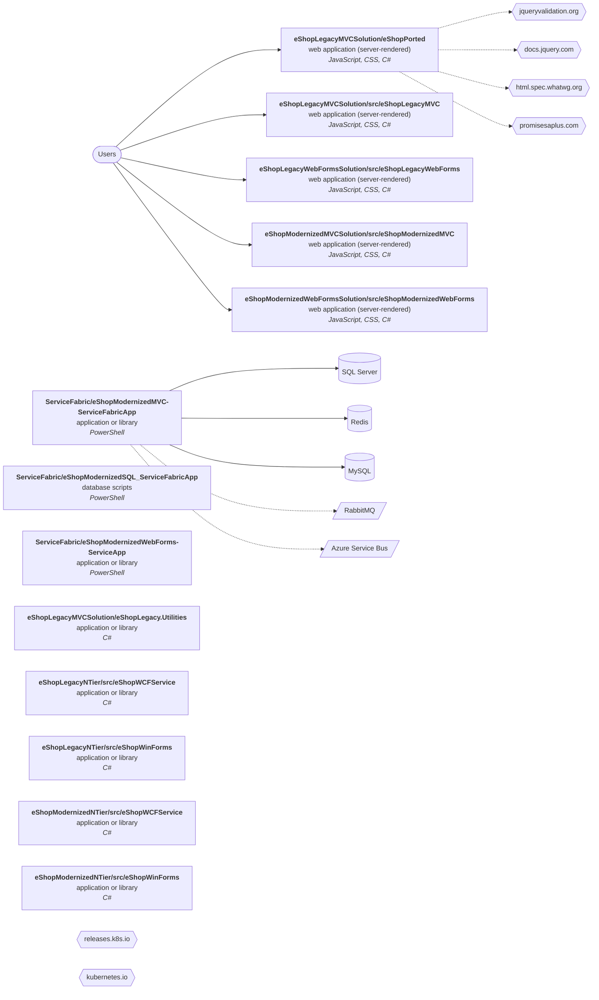

# Technical report: eShopModernizing

Generated by Software Archaeology 2.0.0 on 2026-11-10 · commit `63bc9ec441` · analysis: deterministic tools only (no AI)

Every finding cites the code it is based on. ✅ marks facts produced by tools; 🤖 marks AI inferences that passed the citation check but deserve a second look.

## Summary

| Severity | Findings |
|---|---|
| 🔴 critical | 2 |
| 🟠 high | 7 |
| 🟡 medium | 7 |
| 🔵 low | 1 |

## Inventory

- **Size:** 262,830 lines of code in 1,039 files (large).
- **History:** 381 commits by 19 contributors, 2017-08-10 → 2023-10-25; bus factor 2.

| Language | Files | Lines of code |
|---|---:|---:|
| JavaScript | 129 | 181,413 |
| CSS | 30 | 64,458 |
| C# | 214 | 12,280 |
| Razor | 28 | 1,560 |
| ASP.NET Web Forms | 18 | 1,151 |
| PowerShell | 10 | 926 |
| TypeScript | 5 | 660 |
| Shell | 2 | 168 |
| SQL | 12 | 108 |
| Ruby | 2 | 90 |
| Batch | 1 | 16 |

**Frameworks and platforms**

- .NET net461 — [`eShopLegacyMVCSolution/eShopPorted/eShopPorted.csproj:3`](https://github.com/dotnet-architecture/eShopModernizing/blob/63bc9ec4414d7e281dc9f9d7bdcf70030950457d/eShopLegacyMVCSolution/eShopPorted/eShopPorted.csproj#L3)
- .NET Framework 4.6.1 — [`eShopLegacyMVCSolution/eShopLegacy.Utilities/eShopLegacy.Utilities.csproj:12`](https://github.com/dotnet-architecture/eShopModernizing/blob/63bc9ec4414d7e281dc9f9d7bdcf70030950457d/eShopLegacyMVCSolution/eShopLegacy.Utilities/eShopLegacy.Utilities.csproj#L12)
- ASP.NET Core — [`eShopLegacyMVCSolution/eShopPorted/eShopPorted.csproj:1`](https://github.com/dotnet-architecture/eShopModernizing/blob/63bc9ec4414d7e281dc9f9d7bdcf70030950457d/eShopLegacyMVCSolution/eShopPorted/eShopPorted.csproj#L1)
- ASP.NET MVC — [`eShopLegacyMVCSolution/src/eShopLegacyMVC/eShopLegacyMVC.csproj:205`](https://github.com/dotnet-architecture/eShopModernizing/blob/63bc9ec4414d7e281dc9f9d7bdcf70030950457d/eShopLegacyMVCSolution/src/eShopLegacyMVC/eShopLegacyMVC.csproj#L205)
- ASP.NET Web Forms — [`eShopLegacyWebFormsSolution/src/eShopLegacyWebForms/About.aspx`](https://github.com/dotnet-architecture/eShopModernizing/blob/63bc9ec4414d7e281dc9f9d7bdcf70030950457d/eShopLegacyWebFormsSolution/src/eShopLegacyWebForms/About.aspx)
- Entity Framework — [`eShopLegacyMVCSolution/eShopPorted/eShopPorted.csproj:19`](https://github.com/dotnet-architecture/eShopModernizing/blob/63bc9ec4414d7e281dc9f9d7bdcf70030950457d/eShopLegacyMVCSolution/eShopPorted/eShopPorted.csproj#L19)
- WCF / ASMX web services — [`eShopLegacyNTier/src/eShopWCFService/CatalogService.svc`](https://github.com/dotnet-architecture/eShopModernizing/blob/63bc9ec4414d7e281dc9f9d7bdcf70030950457d/eShopLegacyNTier/src/eShopWCFService/CatalogService.svc)

## Architecture (containers)

| Component | Kind | Languages | Manifests |
|---|---|---|---|
| `ServiceFabric/eShopModernizedMVC-ServiceFabricApp` | application or library | PowerShell | `ServiceFabric/eShopModernizedMVC-ServiceFabricApp/packages.config` |
| `ServiceFabric/eShopModernizedSQL_ServiceFabricApp` | database scripts | PowerShell | `ServiceFabric/eShopModernizedSQL_ServiceFabricApp/packages.config` |
| `ServiceFabric/eShopModernizedWebForms-ServiceApp` | application or library | PowerShell | `ServiceFabric/eShopModernizedWebForms-ServiceApp/packages.config` |
| `eShopLegacyMVCSolution/eShopLegacy.Utilities` | application or library | C# | `eShopLegacyMVCSolution/eShopLegacy.Utilities/eShopLegacy.Utilities.csproj` |
| `eShopLegacyMVCSolution/eShopPorted` | web application (server-rendered) | JavaScript, CSS, C#, Razor | `eShopLegacyMVCSolution/eShopPorted/eShopPorted.csproj` |
| `eShopLegacyMVCSolution/src/eShopLegacyMVC` | web application (server-rendered) | JavaScript, CSS, C#, Razor | `eShopLegacyMVCSolution/src/eShopLegacyMVC/eShopLegacyMVC.csproj`, `eShopLegacyMVCSolution/src/eShopLegacyMVC/packages.config` |
| `eShopLegacyNTier/src/eShopWCFService` | application or library | C# | `eShopLegacyNTier/src/eShopWCFService/eShopWCFService.csproj`, `eShopLegacyNTier/src/eShopWCFService/packages.config` |
| `eShopLegacyNTier/src/eShopWinForms` | application or library | C# | `eShopLegacyNTier/src/eShopWinForms/eShopWinForms.csproj`, `eShopLegacyNTier/src/eShopWinForms/packages.config` |
| `eShopLegacyWebFormsSolution/src/eShopLegacyWebForms` | web application (server-rendered) | JavaScript, CSS, C#, ASP.NET Web Forms | `eShopLegacyWebFormsSolution/src/eShopLegacyWebForms/eShopLegacyWebForms.csproj`, `eShopLegacyWebFormsSolution/src/eShopLegacyWebForms/packages.config` |
| `eShopModernizedMVCSolution/src/eShopModernizedMVC` | web application (server-rendered) | JavaScript, CSS, C#, Razor | `eShopModernizedMVCSolution/src/eShopModernizedMVC/eShopModernizedMVC.csproj`, `eShopModernizedMVCSolution/src/eShopModernizedMVC/packages.config` |
| `eShopModernizedNTier/src/eShopWCFService` | application or library | C# | `eShopModernizedNTier/src/eShopWCFService/eShopWCFService.csproj`, `eShopModernizedNTier/src/eShopWCFService/packages.config` |
| `eShopModernizedNTier/src/eShopWinForms` | application or library | C# | `eShopModernizedNTier/src/eShopWinForms/eShopWinForms.csproj`, `eShopModernizedNTier/src/eShopWinForms/eShopWinForms.fx.csproj` |
| `eShopModernizedWebFormsSolution/src/eShopModernizedWebForms` | web application (server-rendered) | JavaScript, CSS, C#, ASP.NET Web Forms | `eShopModernizedWebFormsSolution/src/eShopModernizedWebForms/eShopModernizedWebForms.csproj`, `eShopModernizedWebFormsSolution/src/eShopModernizedWebForms/packages.config` |

## Dependencies and end of life

458 declared dependencies, 10 runtime declarations.

| Technology | Version | Cycle | End of life | Status | Declared in |
|---|---|---|---|---|---|
| .NET Framework | 4.6.1 | 4.6 | 2022-04-26 | ⛔ past EOL | [`eShopLegacyMVCSolution/eShopLegacy.Utilities/eShopLegacy.Utilities.csproj:12`](https://github.com/dotnet-architecture/eShopModernizing/blob/63bc9ec4414d7e281dc9f9d7bdcf70030950457d/eShopLegacyMVCSolution/eShopLegacy.Utilities/eShopLegacy.Utilities.csproj#L12) |
| .NET Framework | 4.7.2 | 4.7 | False | supported | [`eShopLegacyMVCSolution/src/eShopLegacyMVC/eShopLegacyMVC.csproj:19`](https://github.com/dotnet-architecture/eShopModernizing/blob/63bc9ec4414d7e281dc9f9d7bdcf70030950457d/eShopLegacyMVCSolution/src/eShopLegacyMVC/eShopLegacyMVC.csproj#L19) |
| .NET Framework | 4.7 | 4.7 | False | supported | [`eShopLegacyNTier/src/eShopWinForms/eShopWinForms.csproj:11`](https://github.com/dotnet-architecture/eShopModernizing/blob/63bc9ec4414d7e281dc9f9d7bdcf70030950457d/eShopLegacyNTier/src/eShopWinForms/eShopWinForms.csproj#L11) |
| .NET Framework | 4.7.1 | 4.7 | False | supported | [`eShopModernizedNTier/src/eShopWinForms/eShopWinForms.fx.csproj:11`](https://github.com/dotnet-architecture/eShopModernizing/blob/63bc9ec4414d7e281dc9f9d7bdcf70030950457d/eShopModernizedNTier/src/eShopWinForms/eShopWinForms.fx.csproj#L11) |
| Bootstrap | 4.3.1 | 4 | 2023-01-01 | ⛔ past EOL | [`eShopLegacyMVCSolution/src/eShopLegacyMVC/packages.config:6`](https://github.com/dotnet-architecture/eShopModernizing/blob/63bc9ec4414d7e281dc9f9d7bdcf70030950457d/eShopLegacyMVCSolution/src/eShopLegacyMVC/packages.config#L6) |
| jQuery | 3.5.0 | 3 | False | supported | [`eShopLegacyMVCSolution/src/eShopLegacyMVC/packages.config:8`](https://github.com/dotnet-architecture/eShopModernizing/blob/63bc9ec4414d7e281dc9f9d7bdcf70030950457d/eShopLegacyMVCSolution/src/eShopLegacyMVC/packages.config#L8) |

## Hotspots (complexity × change frequency)

| File | Branches | Commits | Authors | Last change | Score |
|---|---:|---:|---:|---|---:|
| [`eShopLegacyMVCSolution/eShopPorted/wwwroot/Scripts/jquery-3.3.1.js`](https://github.com/dotnet-architecture/eShopModernizing/blob/63bc9ec4414d7e281dc9f9d7bdcf70030950457d/eShopLegacyMVCSolution/eShopPorted/wwwroot/Scripts/jquery-3.3.1.js) | 2370 | 1 | 1 | 2021-09-14 | 2.3 |
| [`eShopLegacyMVCSolution/src/eShopLegacyMVC/Scripts/jquery-3.3.1.js`](https://github.com/dotnet-architecture/eShopModernizing/blob/63bc9ec4414d7e281dc9f9d7bdcf70030950457d/eShopLegacyMVCSolution/src/eShopLegacyMVC/Scripts/jquery-3.3.1.js) | 2370 | 1 | 1 | 2019-03-14 | 2.3 |
| [`eShopLegacyWebFormsSolution/src/eShopLegacyWebForms/Scripts/jquery-3.3.1.js`](https://github.com/dotnet-architecture/eShopModernizing/blob/63bc9ec4414d7e281dc9f9d7bdcf70030950457d/eShopLegacyWebFormsSolution/src/eShopLegacyWebForms/Scripts/jquery-3.3.1.js) | 2370 | 1 | 1 | 2019-03-14 | 2.3 |
| [`eShopLegacyWebFormsSolution/src/eShopLegacyWebForms/Scripts/bootstrap.bundle.js`](https://github.com/dotnet-architecture/eShopModernizing/blob/63bc9ec4414d7e281dc9f9d7bdcf70030950457d/eShopLegacyWebFormsSolution/src/eShopLegacyWebForms/Scripts/bootstrap.bundle.js) | 977 | 2 | 1 | 2019-03-14 | 1.9 |
| [`eShopModernizedWebFormsSolution/src/eShopModernizedWebForms/Scripts/bootstrap.bundle.js`](https://github.com/dotnet-architecture/eShopModernizing/blob/63bc9ec4414d7e281dc9f9d7bdcf70030950457d/eShopModernizedWebFormsSolution/src/eShopModernizedWebForms/Scripts/bootstrap.bundle.js) | 977 | 2 | 2 | 2019-03-14 | 1.9 |
| [`eShopLegacyMVCSolution/eShopPorted/wwwroot/Scripts/jquery-3.3.1.slim.js`](https://github.com/dotnet-architecture/eShopModernizing/blob/63bc9ec4414d7e281dc9f9d7bdcf70030950457d/eShopLegacyMVCSolution/eShopPorted/wwwroot/Scripts/jquery-3.3.1.slim.js) | 1883 | 1 | 1 | 2021-09-14 | 1.8 |
| [`eShopLegacyMVCSolution/src/eShopLegacyMVC/Scripts/jquery-3.3.1.slim.js`](https://github.com/dotnet-architecture/eShopModernizing/blob/63bc9ec4414d7e281dc9f9d7bdcf70030950457d/eShopLegacyMVCSolution/src/eShopLegacyMVC/Scripts/jquery-3.3.1.slim.js) | 1883 | 1 | 1 | 2019-03-14 | 1.8 |
| [`eShopLegacyWebFormsSolution/src/eShopLegacyWebForms/Scripts/jquery-3.3.1.slim.js`](https://github.com/dotnet-architecture/eShopModernizing/blob/63bc9ec4414d7e281dc9f9d7bdcf70030950457d/eShopLegacyWebFormsSolution/src/eShopLegacyWebForms/Scripts/jquery-3.3.1.slim.js) | 1883 | 1 | 1 | 2019-03-14 | 1.8 |
| [`eShopLegacyWebFormsSolution/src/eShopLegacyWebForms/Scripts/bootstrap.js`](https://github.com/dotnet-architecture/eShopModernizing/blob/63bc9ec4414d7e281dc9f9d7bdcf70030950457d/eShopLegacyWebFormsSolution/src/eShopLegacyWebForms/Scripts/bootstrap.js) | 573 | 3 | 2 | 2019-03-14 | 1.6 |
| [`eShopModernizedWebFormsSolution/src/eShopModernizedWebForms/Scripts/bootstrap.js`](https://github.com/dotnet-architecture/eShopModernizing/blob/63bc9ec4414d7e281dc9f9d7bdcf70030950457d/eShopModernizedWebFormsSolution/src/eShopModernizedWebForms/Scripts/bootstrap.js) | 573 | 3 | 3 | 2019-03-14 | 1.6 |
| [`eShopLegacyMVCSolution/src/eShopLegacyMVC/Scripts/bootstrap.js`](https://github.com/dotnet-architecture/eShopModernizing/blob/63bc9ec4414d7e281dc9f9d7bdcf70030950457d/eShopLegacyMVCSolution/src/eShopLegacyMVC/Scripts/bootstrap.js) | 573 | 2 | 2 | 2019-03-14 | 1.1 |
| [`eShopLegacyMVCSolution/eShopPorted/wwwroot/Scripts/bootstrap.bundle.js`](https://github.com/dotnet-architecture/eShopModernizing/blob/63bc9ec4414d7e281dc9f9d7bdcf70030950457d/eShopLegacyMVCSolution/eShopPorted/wwwroot/Scripts/bootstrap.bundle.js) | 977 | 1 | 1 | 2021-09-14 | 0.9 |

## Entry points

ASP.NET: 16, ASP.NET Web Forms: 12, page: 3

| Framework | Method | Path | Where |
|---|---|---|---|
| ASP.NET | POST | (named by its controller) | [`eShopLegacyMVCSolution/eShopPorted/Controllers/CatalogController.cs:61`](https://github.com/dotnet-architecture/eShopModernizing/blob/63bc9ec4414d7e281dc9f9d7bdcf70030950457d/eShopLegacyMVCSolution/eShopPorted/Controllers/CatalogController.cs#L61) |
| ASP.NET | POST | (named by its controller) | [`eShopLegacyMVCSolution/eShopPorted/Controllers/CatalogController.cs:99`](https://github.com/dotnet-architecture/eShopModernizing/blob/63bc9ec4414d7e281dc9f9d7bdcf70030950457d/eShopLegacyMVCSolution/eShopPorted/Controllers/CatalogController.cs#L99) |
| ASP.NET | GET | (named by its controller) | [`eShopLegacyMVCSolution/eShopPorted/Controllers/PicController.cs:23`](https://github.com/dotnet-architecture/eShopModernizing/blob/63bc9ec4414d7e281dc9f9d7bdcf70030950457d/eShopLegacyMVCSolution/eShopPorted/Controllers/PicController.cs#L23) |
| ASP.NET | DELETE | `{id}` | [`eShopLegacyMVCSolution/eShopPorted/Controllers/Api/BrandsController.cs:24`](https://github.com/dotnet-architecture/eShopModernizing/blob/63bc9ec4414d7e281dc9f9d7bdcf70030950457d/eShopLegacyMVCSolution/eShopPorted/Controllers/Api/BrandsController.cs#L24) |
| ASP.NET |  | `api/[controller]` | [`eShopLegacyMVCSolution/eShopPorted/Controllers/Api/BrandsController.cs:8`](https://github.com/dotnet-architecture/eShopModernizing/blob/63bc9ec4414d7e281dc9f9d7bdcf70030950457d/eShopLegacyMVCSolution/eShopPorted/Controllers/Api/BrandsController.cs#L8) |
| ASP.NET |  | `api/[controller]` | [`eShopLegacyMVCSolution/eShopPorted/Controllers/Api/FilesController.cs:10`](https://github.com/dotnet-architecture/eShopModernizing/blob/63bc9ec4414d7e281dc9f9d7bdcf70030950457d/eShopLegacyMVCSolution/eShopPorted/Controllers/Api/FilesController.cs#L10) |
| ASP.NET | POST | (named by its controller) | [`eShopLegacyMVCSolution/src/eShopLegacyMVC/Controllers/CatalogController.cs:60`](https://github.com/dotnet-architecture/eShopModernizing/blob/63bc9ec4414d7e281dc9f9d7bdcf70030950457d/eShopLegacyMVCSolution/src/eShopLegacyMVC/Controllers/CatalogController.cs#L60) |
| ASP.NET | POST | (named by its controller) | [`eShopLegacyMVCSolution/src/eShopLegacyMVC/Controllers/CatalogController.cs:98`](https://github.com/dotnet-architecture/eShopModernizing/blob/63bc9ec4414d7e281dc9f9d7bdcf70030950457d/eShopLegacyMVCSolution/src/eShopLegacyMVC/Controllers/CatalogController.cs#L98) |
| ASP.NET | GET | (named by its controller) | [`eShopLegacyMVCSolution/src/eShopLegacyMVC/Controllers/PicController.cs:23`](https://github.com/dotnet-architecture/eShopModernizing/blob/63bc9ec4414d7e281dc9f9d7bdcf70030950457d/eShopLegacyMVCSolution/src/eShopLegacyMVC/Controllers/PicController.cs#L23) |
| ASP.NET | GET | (named by its controller) | [`eShopLegacyMVCSolution/src/eShopLegacyMVC/Controllers/Api/CatalogController.cs:8`](https://github.com/dotnet-architecture/eShopModernizing/blob/63bc9ec4414d7e281dc9f9d7bdcf70030950457d/eShopLegacyMVCSolution/src/eShopLegacyMVC/Controllers/Api/CatalogController.cs#L8) |
| ASP.NET |  | `api` | [`eShopLegacyMVCSolution/src/eShopLegacyMVC/Controllers/Api/CatalogController.cs:5`](https://github.com/dotnet-architecture/eShopModernizing/blob/63bc9ec4414d7e281dc9f9d7bdcf70030950457d/eShopLegacyMVCSolution/src/eShopLegacyMVC/Controllers/Api/CatalogController.cs#L5) |
| ASP.NET | DELETE | (named by its controller) | [`eShopLegacyMVCSolution/src/eShopLegacyMVC/Controllers/WebApi/BrandsController.cs:38`](https://github.com/dotnet-architecture/eShopModernizing/blob/63bc9ec4414d7e281dc9f9d7bdcf70030950457d/eShopLegacyMVCSolution/src/eShopLegacyMVC/Controllers/WebApi/BrandsController.cs#L38) |
| ASP.NET | POST | (named by its controller) | [`eShopModernizedMVCSolution/src/eShopModernizedMVC/Controllers/CatalogController.cs:69`](https://github.com/dotnet-architecture/eShopModernizing/blob/63bc9ec4414d7e281dc9f9d7bdcf70030950457d/eShopModernizedMVCSolution/src/eShopModernizedMVC/Controllers/CatalogController.cs#L69) |
| ASP.NET | POST | (named by its controller) | [`eShopModernizedMVCSolution/src/eShopModernizedMVC/Controllers/CatalogController.cs:122`](https://github.com/dotnet-architecture/eShopModernizing/blob/63bc9ec4414d7e281dc9f9d7bdcf70030950457d/eShopModernizedMVCSolution/src/eShopModernizedMVC/Controllers/CatalogController.cs#L122) |
| ASP.NET | POST | (named by its controller) | [`eShopModernizedMVCSolution/src/eShopModernizedMVC/Controllers/PicController.cs:25`](https://github.com/dotnet-architecture/eShopModernizing/blob/63bc9ec4414d7e281dc9f9d7bdcf70030950457d/eShopModernizedMVCSolution/src/eShopModernizedMVC/Controllers/PicController.cs#L25) |
| ASP.NET |  | `uploadimage` | [`eShopModernizedMVCSolution/src/eShopModernizedMVC/Controllers/PicController.cs:26`](https://github.com/dotnet-architecture/eShopModernizing/blob/63bc9ec4414d7e281dc9f9d7bdcf70030950457d/eShopModernizedMVCSolution/src/eShopModernizedMVC/Controllers/PicController.cs#L26) |
| page |  | `/eShopLegacyNTier/src/eShopWCFService/CatalogService.svc` | [`eShopLegacyNTier/src/eShopWCFService/CatalogService.svc`](https://github.com/dotnet-architecture/eShopModernizing/blob/63bc9ec4414d7e281dc9f9d7bdcf70030950457d/eShopLegacyNTier/src/eShopWCFService/CatalogService.svc) |
| ASP.NET Web Forms |  | `/eShopLegacyWebFormsSolution/src/eShopLegacyWebForms/About.aspx` | [`eShopLegacyWebFormsSolution/src/eShopLegacyWebForms/About.aspx`](https://github.com/dotnet-architecture/eShopModernizing/blob/63bc9ec4414d7e281dc9f9d7bdcf70030950457d/eShopLegacyWebFormsSolution/src/eShopLegacyWebForms/About.aspx) |
| ASP.NET Web Forms |  | `/eShopLegacyWebFormsSolution/src/eShopLegacyWebForms/Contact.aspx` | [`eShopLegacyWebFormsSolution/src/eShopLegacyWebForms/Contact.aspx`](https://github.com/dotnet-architecture/eShopModernizing/blob/63bc9ec4414d7e281dc9f9d7bdcf70030950457d/eShopLegacyWebFormsSolution/src/eShopLegacyWebForms/Contact.aspx) |
| ASP.NET Web Forms |  | `/eShopLegacyWebFormsSolution/src/eShopLegacyWebForms/Default.aspx` | [`eShopLegacyWebFormsSolution/src/eShopLegacyWebForms/Default.aspx`](https://github.com/dotnet-architecture/eShopModernizing/blob/63bc9ec4414d7e281dc9f9d7bdcf70030950457d/eShopLegacyWebFormsSolution/src/eShopLegacyWebForms/Default.aspx) |
| ASP.NET Web Forms |  | `/eShopLegacyWebFormsSolution/src/eShopLegacyWebForms/Catalog/Create.aspx` | [`eShopLegacyWebFormsSolution/src/eShopLegacyWebForms/Catalog/Create.aspx`](https://github.com/dotnet-architecture/eShopModernizing/blob/63bc9ec4414d7e281dc9f9d7bdcf70030950457d/eShopLegacyWebFormsSolution/src/eShopLegacyWebForms/Catalog/Create.aspx) |
| ASP.NET Web Forms |  | `/eShopLegacyWebFormsSolution/src/eShopLegacyWebForms/Catalog/Delete.aspx` | [`eShopLegacyWebFormsSolution/src/eShopLegacyWebForms/Catalog/Delete.aspx`](https://github.com/dotnet-architecture/eShopModernizing/blob/63bc9ec4414d7e281dc9f9d7bdcf70030950457d/eShopLegacyWebFormsSolution/src/eShopLegacyWebForms/Catalog/Delete.aspx) |
| ASP.NET Web Forms |  | `/eShopLegacyWebFormsSolution/src/eShopLegacyWebForms/Catalog/Details.aspx` | [`eShopLegacyWebFormsSolution/src/eShopLegacyWebForms/Catalog/Details.aspx`](https://github.com/dotnet-architecture/eShopModernizing/blob/63bc9ec4414d7e281dc9f9d7bdcf70030950457d/eShopLegacyWebFormsSolution/src/eShopLegacyWebForms/Catalog/Details.aspx) |
| ASP.NET Web Forms |  | `/eShopLegacyWebFormsSolution/src/eShopLegacyWebForms/Catalog/Edit.aspx` | [`eShopLegacyWebFormsSolution/src/eShopLegacyWebForms/Catalog/Edit.aspx`](https://github.com/dotnet-architecture/eShopModernizing/blob/63bc9ec4414d7e281dc9f9d7bdcf70030950457d/eShopLegacyWebFormsSolution/src/eShopLegacyWebForms/Catalog/Edit.aspx) |
| page |  | `/eShopModernizedNTier/src/eShopWCFService/CatalogService.svc` | [`eShopModernizedNTier/src/eShopWCFService/CatalogService.svc`](https://github.com/dotnet-architecture/eShopModernizing/blob/63bc9ec4414d7e281dc9f9d7bdcf70030950457d/eShopModernizedNTier/src/eShopWCFService/CatalogService.svc) |
| ASP.NET Web Forms |  | `/eShopModernizedWebFormsSolution/src/eShopModernizedWebForms/Default.aspx` | [`eShopModernizedWebFormsSolution/src/eShopModernizedWebForms/Default.aspx`](https://github.com/dotnet-architecture/eShopModernizing/blob/63bc9ec4414d7e281dc9f9d7bdcf70030950457d/eShopModernizedWebFormsSolution/src/eShopModernizedWebForms/Default.aspx) |
| ASP.NET Web Forms |  | `/eShopModernizedWebFormsSolution/src/eShopModernizedWebForms/Catalog/Create.aspx` | [`eShopModernizedWebFormsSolution/src/eShopModernizedWebForms/Catalog/Create.aspx`](https://github.com/dotnet-architecture/eShopModernizing/blob/63bc9ec4414d7e281dc9f9d7bdcf70030950457d/eShopModernizedWebFormsSolution/src/eShopModernizedWebForms/Catalog/Create.aspx) |
| ASP.NET Web Forms |  | `/eShopModernizedWebFormsSolution/src/eShopModernizedWebForms/Catalog/Delete.aspx` | [`eShopModernizedWebFormsSolution/src/eShopModernizedWebForms/Catalog/Delete.aspx`](https://github.com/dotnet-architecture/eShopModernizing/blob/63bc9ec4414d7e281dc9f9d7bdcf70030950457d/eShopModernizedWebFormsSolution/src/eShopModernizedWebForms/Catalog/Delete.aspx) |
| ASP.NET Web Forms |  | `/eShopModernizedWebFormsSolution/src/eShopModernizedWebForms/Catalog/Details.aspx` | [`eShopModernizedWebFormsSolution/src/eShopModernizedWebForms/Catalog/Details.aspx`](https://github.com/dotnet-architecture/eShopModernizing/blob/63bc9ec4414d7e281dc9f9d7bdcf70030950457d/eShopModernizedWebFormsSolution/src/eShopModernizedWebForms/Catalog/Details.aspx) |
| ASP.NET Web Forms |  | `/eShopModernizedWebFormsSolution/src/eShopModernizedWebForms/Catalog/Edit.aspx` | [`eShopModernizedWebFormsSolution/src/eShopModernizedWebForms/Catalog/Edit.aspx`](https://github.com/dotnet-architecture/eShopModernizing/blob/63bc9ec4414d7e281dc9f9d7bdcf70030950457d/eShopModernizedWebFormsSolution/src/eShopModernizedWebForms/Catalog/Edit.aspx) |
| page |  | `/eShopModernizedWebFormsSolution/src/eShopModernizedWebForms/Catalog/PicUploader.asmx` | [`eShopModernizedWebFormsSolution/src/eShopModernizedWebForms/Catalog/PicUploader.asmx`](https://github.com/dotnet-architecture/eShopModernizing/blob/63bc9ec4414d7e281dc9f9d7bdcf70030950457d/eShopModernizedWebFormsSolution/src/eShopModernizedWebForms/Catalog/PicUploader.asmx) |

## Database

- **Stores referenced:** SQL Server, Redis, MySQL
- **Objects in SQL files:** none
- **ORM entities / mappers:** 27

## Tests and delivery

- **Tests:** 0 files, test/source ratio 0.00, frameworks: none
- **CI:** none · **Containers:** 3 Dockerfile(s) · **IaC:** none · **Observability:** log4net, Application Insights

## Findings

### Dependencies

#### DEP-001 · .NET Framework 4.6.1 is past its end of life (2022-04-26)

**Severity:** 🔴 critical · **Confidence:** high · **Effort:** L · ✅ verified by tools

**What it means technically.** Release cycle 4.6 of dotnetfx gets no security or bug fixes since 2022-04-26. The newest cycle is 4.8.1.

**What it means for the business.** Part of the system runs on .NET Framework 4.6.1, which its maker stopped fixing on 2022-04-26. New security holes will stay open, and auditors and insurers usually flag this.

**Recommendation.** Plan an upgrade of .NET Framework to a supported release (4.8.1 or another supported cycle).

**Evidence**

- [`eShopLegacyMVCSolution/eShopLegacy.Utilities/eShopLegacy.Utilities.csproj:12`](https://github.com/dotnet-architecture/eShopModernizing/blob/63bc9ec4414d7e281dc9f9d7bdcf70030950457d/eShopLegacyMVCSolution/eShopLegacy.Utilities/eShopLegacy.Utilities.csproj#L12) — endoflife.date

**References:** <https://endoflife.date/dotnetfx>

#### DEP-002 · Bootstrap 4.3.1 is past its end of life (2023-01-01)

**Severity:** 🟠 high · **Confidence:** high · **Effort:** L · ✅ verified by tools

**What it means technically.** Release cycle 4 of bootstrap gets no security or bug fixes since 2023-01-01. The newest cycle is 5.

**What it means for the business.** Part of the system runs on Bootstrap 4.3.1, which its maker stopped fixing on 2023-01-01. New security holes will stay open, and auditors and insurers usually flag this.

**Recommendation.** Plan an upgrade of Bootstrap to a supported release (5 or another supported cycle).

**Evidence**

- [`eShopLegacyMVCSolution/src/eShopLegacyMVC/packages.config:6`](https://github.com/dotnet-architecture/eShopModernizing/blob/63bc9ec4414d7e281dc9f9d7bdcf70030950457d/eShopLegacyMVCSolution/src/eShopLegacyMVC/packages.config#L6) — endoflife.date

**References:** <https://endoflife.date/bootstrap>

### Architecture

#### ARC-001 · Built on ASP.NET Web Forms

**Severity:** 🟠 high · **Confidence:** high · **Effort:** XL · ✅ verified by tools

**What it means technically.** Web Forms has no successor in modern .NET; pages must be rebuilt (Razor, Blazor or a SPA).

**What it means for the business.** An important part of the system uses ASP.NET Web Forms, a technology that is hard to hire for and cannot be upgraded in place. Moving off it is a project, not an update.

**Recommendation.** Treat leaving ASP.NET Web Forms as its own track in the roadmap, screen by screen or service by service.

**Evidence**

- [`eShopLegacyWebFormsSolution/src/eShopLegacyWebForms/About.aspx`](https://github.com/dotnet-architecture/eShopModernizing/blob/63bc9ec4414d7e281dc9f9d7bdcf70030950457d/eShopLegacyWebFormsSolution/src/eShopLegacyWebForms/About.aspx) — inventory

#### ARC-002 · Built on WCF / ASMX web services

**Severity:** 🟠 high · **Confidence:** high · **Effort:** L · ✅ verified by tools

**What it means technically.** WCF server and ASMX are not available in modern .NET; services must be ported (CoreWCF, REST, gRPC).

**What it means for the business.** An important part of the system uses WCF / ASMX web services, a technology that is hard to hire for and cannot be upgraded in place. Moving off it is a project, not an update.

**Recommendation.** Treat leaving WCF / ASMX web services as its own track in the roadmap, screen by screen or service by service.

**Evidence**

- [`eShopLegacyNTier/src/eShopWCFService/CatalogService.svc`](https://github.com/dotnet-architecture/eShopModernizing/blob/63bc9ec4414d7e281dc9f9d7bdcf70030950457d/eShopLegacyNTier/src/eShopWCFService/CatalogService.svc) — inventory

### Security

#### SEC-001 · Private key found in 1 file(s)

**Severity:** 🔴 critical · **Confidence:** high · **Effort:** S · ✅ verified by tools

**What it means technically.** Credentials are committed to the source tree. Anyone with read access to the repository, its history or a backup can use them.

**What it means for the business.** Passwords or keys are written inside the code. Whoever gets a copy of the code gets access to the systems those keys open.

**Recommendation.** Rotate these credentials now, move them to a secrets store (environment, vault), and purge them from the git history.

**Evidence**

- [`VM/DockerCerts-Generation/CreateDockerCerts.ps1:60`](https://github.com/dotnet-architecture/eShopModernizing/blob/63bc9ec4414d7e281dc9f9d7bdcf70030950457d/VM/DockerCerts-Generation/CreateDockerCerts.ps1#L60) — `Value    = ("[REDACTED-SECRET]`n" + [System.Convert]::ToBase64String($privateKeyFromCert.Key.Export([System.Security.Cryptography.CngKeyBlobFormat]::Pkcs8PrivateBlob), [System.Base64FormattingOptions]`
- [`VM/DockerCerts-Generation/CreateDockerCerts.ps1:91`](https://github.com/dotnet-architecture/eShopModernizing/blob/63bc9ec4414d7e281dc9f9d7bdcf70030950457d/VM/DockerCerts-Generation/CreateDockerCerts.ps1#L91) — `Value    = ("[REDACTED-SECRET]`n" + [System.Convert]::ToBase64String($clientprivateKeyFromCert.Key.Export([System.Security.Cryptography.CngKeyBlobFormat]::Pkcs8PrivateBlob), [System.Base64FormattingOp`

**References:** CWE-798, OWASP A07:2021

#### SEC-002 · Newtonsoft.Json 12.0.1 has 1 known vulnerability, declared in 3 places

**Severity:** 🟠 high · **Confidence:** high · **Effort:** S · ✅ verified by tools

**What it means technically.** OSV lists GHSA-5crp-9r3c-p9vr for this exact version. Improper Handling of Exceptional Conditions in Newtonsoft.Json

**What it means for the business.** Newtonsoft.Json 12.0.1, a library the system depends on, has publicly known security flaws. Attackers read these lists too.

**Recommendation.** Upgrade Newtonsoft.Json to a version without these advisories and re-test the features that use it.

**Evidence**

- [`eShopLegacyMVCSolution/src/eShopLegacyMVC/packages.config:29`](https://github.com/dotnet-architecture/eShopModernizing/blob/63bc9ec4414d7e281dc9f9d7bdcf70030950457d/eShopLegacyMVCSolution/src/eShopLegacyMVC/packages.config#L29) — osv.dev
- [`eShopLegacyWebFormsSolution/src/eShopLegacyWebForms/packages.config:31`](https://github.com/dotnet-architecture/eShopModernizing/blob/63bc9ec4414d7e281dc9f9d7bdcf70030950457d/eShopLegacyWebFormsSolution/src/eShopLegacyWebForms/packages.config#L31) — osv.dev
- [`eShopLegacyMVCSolution/src/eShopLegacyMVC/eShopLegacyMVC.csproj:102`](https://github.com/dotnet-architecture/eShopModernizing/blob/63bc9ec4414d7e281dc9f9d7bdcf70030950457d/eShopLegacyMVCSolution/src/eShopLegacyMVC/eShopLegacyMVC.csproj#L102) — osv.dev

**References:** <https://osv.dev/vulnerability/GHSA-5crp-9r3c-p9vr>

#### SEC-003 · Newtonsoft.Json 6.0.4 has 1 known vulnerability

**Severity:** 🟠 high · **Confidence:** high · **Effort:** S · ✅ verified by tools

**What it means technically.** OSV lists GHSA-5crp-9r3c-p9vr for this exact version. Improper Handling of Exceptional Conditions in Newtonsoft.Json

**What it means for the business.** Newtonsoft.Json 6.0.4, a library the system depends on, has publicly known security flaws. Attackers read these lists too.

**Recommendation.** Upgrade Newtonsoft.Json to a version without these advisories and re-test the features that use it.

**Evidence**

- [`eShopLegacyNTier/src/eShopWinForms/packages.config:5`](https://github.com/dotnet-architecture/eShopModernizing/blob/63bc9ec4414d7e281dc9f9d7bdcf70030950457d/eShopLegacyNTier/src/eShopWinForms/packages.config#L5) — osv.dev

**References:** <https://osv.dev/vulnerability/GHSA-5crp-9r3c-p9vr>

#### SEC-004 · Password inside a connection string found in 20 file(s)

**Severity:** 🟠 high · **Confidence:** high · **Effort:** S · ✅ verified by tools

**What it means technically.** Credentials are committed to the source tree. Anyone with read access to the repository, its history or a backup can use them.

**What it means for the business.** Passwords or keys are written inside the code. Whoever gets a copy of the code gets access to the systems those keys open.

**Recommendation.** Rotate these credentials now, move them to a secrets store (environment, vault), and purge them from the git history.

**Evidence**

- [`docker-compose.override.yml:6`](https://github.com/dotnet-architecture/eShopModernizing/blob/63bc9ec4414d7e281dc9f9d7bdcf70030950457d/docker-compose.override.yml#L6) — `- CatalogDBContext=Server=sql.data;Database=Microsoft.eShopOnContainers.Services.CatalogDb;User Id=sa;Password=[REDACTED-SECRET]
- [`docker-compose.override.yml:21`](https://github.com/dotnet-architecture/eShopModernizing/blob/63bc9ec4414d7e281dc9f9d7bdcf70030950457d/docker-compose.override.yml#L21) — `- CatalogDBContext=Server=sql.data;Database=Microsoft.eShopOnContainers.Services.CatalogDb;User Id=sa;Password=[REDACTED-SECRET]
- [`docker-compose.override.yml:36`](https://github.com/dotnet-architecture/eShopModernizing/blob/63bc9ec4414d7e281dc9f9d7bdcf70030950457d/docker-compose.override.yml#L36) — `- CatalogDBContext=Server=sql.data;Database=eShopDatabase;User Id=sa;Password=[REDACTED-SECRET]
- [`Kubernetes/eShopModernizedMVC-K8s/ServiceDeployments/eshop-modernized-mvc-k8s-services-CD-deployment.yml:25`](https://github.com/dotnet-architecture/eShopModernizing/blob/63bc9ec4414d7e281dc9f9d7bdcf70030950457d/Kubernetes/eShopModernizedMVC-K8s/ServiceDeployments/eshop-modernized-mvc-k8s-services-CD-deployment.yml#L25) — `value: "Server=sql-data;Database=Microsoft.eShopOnContainers.Services.CatalogDb;User Id=sa;Password=[REDACTED-SECRET]"`
- [`Kubernetes/eShopModernizedMVC-K8s/ServiceDeployments/eshop-modernized-mvc-k8s-services-deployment.yml:25`](https://github.com/dotnet-architecture/eShopModernizing/blob/63bc9ec4414d7e281dc9f9d7bdcf70030950457d/Kubernetes/eShopModernizedMVC-K8s/ServiceDeployments/eshop-modernized-mvc-k8s-services-deployment.yml#L25) — `value: "Server=sql-data;Database=Microsoft.eShopOnContainers.Services.CatalogDb;User Id=sa;Password=[REDACTED-SECRET]"`
- [`Kubernetes/eShopModernizedNTier-WCF-K8s/eshop-wcf-container-deployment.yml:25`](https://github.com/dotnet-architecture/eShopModernizing/blob/63bc9ec4414d7e281dc9f9d7bdcf70030950457d/Kubernetes/eShopModernizedNTier-WCF-K8s/eshop-wcf-container-deployment.yml#L25) — `value: "Server=sql-data-for-wcf;Database=eShopDatabase;User Id=sa;Password=[REDACTED-SECRET]"`
- [`Kubernetes/eShopModernizedWebForms-K8s/eshop-modernized-webforms-k8s-services-CD-deployment.yml:25`](https://github.com/dotnet-architecture/eShopModernizing/blob/63bc9ec4414d7e281dc9f9d7bdcf70030950457d/Kubernetes/eShopModernizedWebForms-K8s/eshop-modernized-webforms-k8s-services-CD-deployment.yml#L25) — `value: "Server=sql-data;Database=Microsoft.eShopOnContainers.Services.CatalogDb;User Id=sa;Password=[REDACTED-SECRET]"`
- [`Kubernetes/eShopModernizedWebForms-K8s/eshop-modernized-webforms-k8s-services-deployment.yml:29`](https://github.com/dotnet-architecture/eShopModernizing/blob/63bc9ec4414d7e281dc9f9d7bdcf70030950457d/Kubernetes/eShopModernizedWebForms-K8s/eshop-modernized-webforms-k8s-services-deployment.yml#L29) — `value: "Server=sql-data;Database=Microsoft.eShopOnContainers.Services.CatalogDb;User Id=sa;Password=[REDACTED-SECRET]"`
- [`Kubernetes-DockerForWindows/eShopModernizedMVC-K8s/eshop-modernized-mvc-k8s-compose.yml:10`](https://github.com/dotnet-architecture/eShopModernizing/blob/63bc9ec4414d7e281dc9f9d7bdcf70030950457d/Kubernetes-DockerForWindows/eShopModernizedMVC-K8s/eshop-modernized-mvc-k8s-compose.yml#L10) — `- ConnectionString=Server=sql.data;Database=Microsoft.eShopOnContainers.Services.CatalogDb;User Id=sa;Password=[REDACTED-SECRET]
- [`Kubernetes-DockerForWindows/eShopModernizedMVC-K8s/eshop-modernized-mvc-k8s-services-deployment.yml:25`](https://github.com/dotnet-architecture/eShopModernizing/blob/63bc9ec4414d7e281dc9f9d7bdcf70030950457d/Kubernetes-DockerForWindows/eShopModernizedMVC-K8s/eshop-modernized-mvc-k8s-services-deployment.yml#L25) — `value: "Server=sql-data;Database=Microsoft.eShopOnContainers.Services.CatalogDb;User Id=sa;Password=[REDACTED-SECRET]"`

**References:** CWE-798, OWASP A07:2021

#### SEC-005 · Microsoft.IdentityModel.JsonWebTokens 5.6.0 has 1 known vulnerability, declared in 2 places

**Severity:** 🟡 medium · **Confidence:** high · **Effort:** S · ✅ verified by tools

**What it means technically.** OSV lists GHSA-59j7-ghrg-fj52 for this exact version. Microsoft ASP.NET Core project templates vulnerable to denial of service

**What it means for the business.** Microsoft.IdentityModel.JsonWebTokens 5.6.0, a library the system depends on, has publicly known security flaws. Attackers read these lists too.

**Recommendation.** Upgrade Microsoft.IdentityModel.JsonWebTokens to a version without these advisories and re-test the features that use it.

**Evidence**

- [`eShopModernizedMVCSolution/src/eShopModernizedMVC/packages.config:51`](https://github.com/dotnet-architecture/eShopModernizing/blob/63bc9ec4414d7e281dc9f9d7bdcf70030950457d/eShopModernizedMVCSolution/src/eShopModernizedMVC/packages.config#L51) — osv.dev
- [`eShopModernizedWebFormsSolution/src/eShopModernizedWebForms/packages.config:53`](https://github.com/dotnet-architecture/eShopModernizing/blob/63bc9ec4414d7e281dc9f9d7bdcf70030950457d/eShopModernizedWebFormsSolution/src/eShopModernizedWebForms/packages.config#L53) — osv.dev

**References:** <https://osv.dev/vulnerability/GHSA-59j7-ghrg-fj52>

#### SEC-006 · System.IdentityModel.Tokens.Jwt 5.6.0 has 1 known vulnerability, declared in 2 places

**Severity:** 🟡 medium · **Confidence:** high · **Effort:** S · ✅ verified by tools

**What it means technically.** OSV lists GHSA-59j7-ghrg-fj52 for this exact version. Microsoft ASP.NET Core project templates vulnerable to denial of service

**What it means for the business.** System.IdentityModel.Tokens.Jwt 5.6.0, a library the system depends on, has publicly known security flaws. Attackers read these lists too.

**Recommendation.** Upgrade System.IdentityModel.Tokens.Jwt to a version without these advisories and re-test the features that use it.

**Evidence**

- [`eShopModernizedMVCSolution/src/eShopModernizedMVC/packages.config:97`](https://github.com/dotnet-architecture/eShopModernizing/blob/63bc9ec4414d7e281dc9f9d7bdcf70030950457d/eShopModernizedMVCSolution/src/eShopModernizedMVC/packages.config#L97) — osv.dev
- [`eShopModernizedWebFormsSolution/src/eShopModernizedWebForms/packages.config:98`](https://github.com/dotnet-architecture/eShopModernizing/blob/63bc9ec4414d7e281dc9f9d7bdcf70030950457d/eShopModernizedWebFormsSolution/src/eShopModernizedWebForms/packages.config#L98) — osv.dev

**References:** <https://osv.dev/vulnerability/GHSA-59j7-ghrg-fj52>

#### SEC-007 · log4net 2.0.10 has 1 known vulnerability, declared in 5 places

**Severity:** 🟡 medium · **Confidence:** high · **Effort:** S · ✅ verified by tools

**What it means technically.** OSV lists GHSA-4f7c-pmjv-c25w for this exact version. Apache Log4net: Silent log event loss in XmlLayout and XmlLayoutSchemaLog4J due to unescaped XML 1.0 forbidden characters

**What it means for the business.** log4net 2.0.10, a library the system depends on, has publicly known security flaws. Attackers read these lists too.

**Recommendation.** Upgrade log4net to a version without these advisories and re-test the features that use it.

**Evidence**

- [`eShopLegacyMVCSolution/src/eShopLegacyMVC/packages.config:10`](https://github.com/dotnet-architecture/eShopModernizing/blob/63bc9ec4414d7e281dc9f9d7bdcf70030950457d/eShopLegacyMVCSolution/src/eShopLegacyMVC/packages.config#L10) — osv.dev
- [`eShopLegacyWebFormsSolution/src/eShopLegacyWebForms/packages.config:11`](https://github.com/dotnet-architecture/eShopModernizing/blob/63bc9ec4414d7e281dc9f9d7bdcf70030950457d/eShopLegacyWebFormsSolution/src/eShopLegacyWebForms/packages.config#L11) — osv.dev
- [`eShopModernizedWebFormsSolution/src/eShopModernizedWebForms/packages.config:11`](https://github.com/dotnet-architecture/eShopModernizing/blob/63bc9ec4414d7e281dc9f9d7bdcf70030950457d/eShopModernizedWebFormsSolution/src/eShopModernizedWebForms/packages.config#L11) — osv.dev
- [`eShopLegacyMVCSolution/eShopPorted/eShopPorted.csproj:13`](https://github.com/dotnet-architecture/eShopModernizing/blob/63bc9ec4414d7e281dc9f9d7bdcf70030950457d/eShopLegacyMVCSolution/eShopPorted/eShopPorted.csproj#L13) — osv.dev
- [`eShopLegacyMVCSolution/src/eShopLegacyMVC/eShopLegacyMVC.csproj:242`](https://github.com/dotnet-architecture/eShopModernizing/blob/63bc9ec4414d7e281dc9f9d7bdcf70030950457d/eShopLegacyMVCSolution/src/eShopLegacyMVC/eShopLegacyMVC.csproj#L242) — osv.dev

**References:** <https://osv.dev/vulnerability/GHSA-4f7c-pmjv-c25w>

#### SEC-008 · log4net 2.0.12 has 1 known vulnerability

**Severity:** 🟡 medium · **Confidence:** high · **Effort:** S · ✅ verified by tools

**What it means technically.** OSV lists GHSA-4f7c-pmjv-c25w for this exact version. Apache Log4net: Silent log event loss in XmlLayout and XmlLayoutSchemaLog4J due to unescaped XML 1.0 forbidden characters

**What it means for the business.** log4net 2.0.12, a library the system depends on, has publicly known security flaws. Attackers read these lists too.

**Recommendation.** Upgrade log4net to a version without these advisories and re-test the features that use it.

**Evidence**

- [`eShopModernizedMVCSolution/src/eShopModernizedMVC/packages.config:10`](https://github.com/dotnet-architecture/eShopModernizing/blob/63bc9ec4414d7e281dc9f9d7bdcf70030950457d/eShopModernizedMVCSolution/src/eShopModernizedMVC/packages.config#L10) — osv.dev

**References:** <https://osv.dev/vulnerability/GHSA-4f7c-pmjv-c25w>

### Testing

#### TST-001 · No automated tests were found

**Severity:** 🟠 high · **Confidence:** high · **Effort:** L · ✅ verified by tools

**What it means technically.** 0 test files for 194,551 lines of source code. Regressions can only be caught by hand.

**What it means for the business.** Nothing checks automatically that the system still works after a change. Every change, and especially a migration, needs slow manual testing and still risks breaking things.

**Recommendation.** Before modernizing, add characterization tests around the most used features and the hotspots.

**Evidence**

- [`ServiceFabric/eShopModernizedMVC-ServiceFabricApp/packages.config`](https://github.com/dotnet-architecture/eShopModernizing/blob/63bc9ec4414d7e281dc9f9d7bdcf70030950457d/ServiceFabric/eShopModernizedMVC-ServiceFabricApp/packages.config) — inventory
- [`ServiceFabric/eShopModernizedSQL_ServiceFabricApp/packages.config`](https://github.com/dotnet-architecture/eShopModernizing/blob/63bc9ec4414d7e281dc9f9d7bdcf70030950457d/ServiceFabric/eShopModernizedSQL_ServiceFabricApp/packages.config) — inventory
- [`ServiceFabric/eShopModernizedWebForms-ServiceApp/packages.config`](https://github.com/dotnet-architecture/eShopModernizing/blob/63bc9ec4414d7e281dc9f9d7bdcf70030950457d/ServiceFabric/eShopModernizedWebForms-ServiceApp/packages.config) — inventory

### Technical debt

#### DEBT-001 · 8 complex files change far more often than the rest

**Severity:** 🟡 medium · **Confidence:** high · **Effort:** L · ✅ verified by tools

**What it means technically.** These files combine high branching with frequent edits: the places where defects and merge conflicts concentrate.

**What it means for the business.** A small set of files absorbs most of the changes and most of the risk. Every new feature that touches them costs more and breaks more often.

**Recommendation.** Cover these files with tests first, then split them along their responsibilities before any larger migration.

**Evidence**

- [`eShopLegacyMVCSolution/eShopPorted/wwwroot/Scripts/jquery-3.3.1.js`](https://github.com/dotnet-architecture/eShopModernizing/blob/63bc9ec4414d7e281dc9f9d7bdcf70030950457d/eShopLegacyMVCSolution/eShopPorted/wwwroot/Scripts/jquery-3.3.1.js) — hotspot: 2370 branches, 1 commits
- [`eShopLegacyMVCSolution/src/eShopLegacyMVC/Scripts/jquery-3.3.1.js`](https://github.com/dotnet-architecture/eShopModernizing/blob/63bc9ec4414d7e281dc9f9d7bdcf70030950457d/eShopLegacyMVCSolution/src/eShopLegacyMVC/Scripts/jquery-3.3.1.js) — hotspot: 2370 branches, 1 commits
- [`eShopLegacyWebFormsSolution/src/eShopLegacyWebForms/Scripts/jquery-3.3.1.js`](https://github.com/dotnet-architecture/eShopModernizing/blob/63bc9ec4414d7e281dc9f9d7bdcf70030950457d/eShopLegacyWebFormsSolution/src/eShopLegacyWebForms/Scripts/jquery-3.3.1.js) — hotspot: 2370 branches, 1 commits
- [`eShopLegacyWebFormsSolution/src/eShopLegacyWebForms/Scripts/bootstrap.bundle.js`](https://github.com/dotnet-architecture/eShopModernizing/blob/63bc9ec4414d7e281dc9f9d7bdcf70030950457d/eShopLegacyWebFormsSolution/src/eShopLegacyWebForms/Scripts/bootstrap.bundle.js) — hotspot: 977 branches, 2 commits
- [`eShopModernizedWebFormsSolution/src/eShopModernizedWebForms/Scripts/bootstrap.bundle.js`](https://github.com/dotnet-architecture/eShopModernizing/blob/63bc9ec4414d7e281dc9f9d7bdcf70030950457d/eShopModernizedWebFormsSolution/src/eShopModernizedWebForms/Scripts/bootstrap.bundle.js) — hotspot: 977 branches, 2 commits
- [`eShopLegacyMVCSolution/eShopPorted/wwwroot/Scripts/jquery-3.3.1.slim.js`](https://github.com/dotnet-architecture/eShopModernizing/blob/63bc9ec4414d7e281dc9f9d7bdcf70030950457d/eShopLegacyMVCSolution/eShopPorted/wwwroot/Scripts/jquery-3.3.1.slim.js) — hotspot: 1883 branches, 1 commits
- [`eShopLegacyMVCSolution/src/eShopLegacyMVC/Scripts/jquery-3.3.1.slim.js`](https://github.com/dotnet-architecture/eShopModernizing/blob/63bc9ec4414d7e281dc9f9d7bdcf70030950457d/eShopLegacyMVCSolution/src/eShopLegacyMVC/Scripts/jquery-3.3.1.slim.js) — hotspot: 1883 branches, 1 commits
- [`eShopLegacyWebFormsSolution/src/eShopLegacyWebForms/Scripts/jquery-3.3.1.slim.js`](https://github.com/dotnet-architecture/eShopModernizing/blob/63bc9ec4414d7e281dc9f9d7bdcf70030950457d/eShopLegacyWebFormsSolution/src/eShopLegacyWebForms/Scripts/jquery-3.3.1.slim.js) — hotspot: 1883 branches, 1 commits

#### DEBT-002 · 10 source files exceed 1,500 lines of code

**Severity:** 🔵 low · **Confidence:** high · **Effort:** M · ✅ verified by tools

**What it means technically.** Very large files usually hold several responsibilities, are hard to test and to review.

**What it means for the business.** Some parts of the code are too big for one person to understand quickly, which slows every change.

**Recommendation.** Break these files apart when they are next changed, guided by tests.

**Evidence**

- [`eShopModernizedMVCSolution/src/eShopModernizedMVC/Scripts/jquery-3.4.1.js`](https://github.com/dotnet-architecture/eShopModernizing/blob/63bc9ec4414d7e281dc9f9d7bdcf70030950457d/eShopModernizedMVCSolution/src/eShopModernizedMVC/Scripts/jquery-3.4.1.js) — 6987 lines
- [`eShopModernizedWebFormsSolution/src/eShopModernizedWebForms/Scripts/jquery-3.4.1.js`](https://github.com/dotnet-architecture/eShopModernizing/blob/63bc9ec4414d7e281dc9f9d7bdcf70030950457d/eShopModernizedWebFormsSolution/src/eShopModernizedWebForms/Scripts/jquery-3.4.1.js) — 6987 lines
- [`eShopLegacyMVCSolution/eShopPorted/wwwroot/Scripts/jquery-3.3.1.js`](https://github.com/dotnet-architecture/eShopModernizing/blob/63bc9ec4414d7e281dc9f9d7bdcf70030950457d/eShopLegacyMVCSolution/eShopPorted/wwwroot/Scripts/jquery-3.3.1.js) — 6877 lines
- [`eShopLegacyMVCSolution/src/eShopLegacyMVC/Scripts/jquery-3.3.1.js`](https://github.com/dotnet-architecture/eShopModernizing/blob/63bc9ec4414d7e281dc9f9d7bdcf70030950457d/eShopLegacyMVCSolution/src/eShopLegacyMVC/Scripts/jquery-3.3.1.js) — 6877 lines
- [`eShopLegacyWebFormsSolution/src/eShopLegacyWebForms/Scripts/jquery-3.3.1.js`](https://github.com/dotnet-architecture/eShopModernizing/blob/63bc9ec4414d7e281dc9f9d7bdcf70030950457d/eShopLegacyWebFormsSolution/src/eShopLegacyWebForms/Scripts/jquery-3.3.1.js) — 6877 lines
- [`eShopModernizedMVCSolution/src/eShopModernizedMVC/Scripts/jquery-3.4.1.slim.js`](https://github.com/dotnet-architecture/eShopModernizing/blob/63bc9ec4414d7e281dc9f9d7bdcf70030950457d/eShopModernizedMVCSolution/src/eShopModernizedMVC/Scripts/jquery-3.4.1.slim.js) — 5563 lines
- [`eShopModernizedWebFormsSolution/src/eShopModernizedWebForms/Scripts/jquery-3.4.1.slim.js`](https://github.com/dotnet-architecture/eShopModernizing/blob/63bc9ec4414d7e281dc9f9d7bdcf70030950457d/eShopModernizedWebFormsSolution/src/eShopModernizedWebForms/Scripts/jquery-3.4.1.slim.js) — 5563 lines
- [`eShopLegacyMVCSolution/eShopPorted/wwwroot/Scripts/jquery-3.3.1.slim.js`](https://github.com/dotnet-architecture/eShopModernizing/blob/63bc9ec4414d7e281dc9f9d7bdcf70030950457d/eShopLegacyMVCSolution/eShopPorted/wwwroot/Scripts/jquery-3.3.1.slim.js) — 5457 lines
- [`eShopLegacyMVCSolution/src/eShopLegacyMVC/Scripts/jquery-3.3.1.slim.js`](https://github.com/dotnet-architecture/eShopModernizing/blob/63bc9ec4414d7e281dc9f9d7bdcf70030950457d/eShopLegacyMVCSolution/src/eShopLegacyMVC/Scripts/jquery-3.3.1.slim.js) — 5457 lines
- [`eShopLegacyWebFormsSolution/src/eShopLegacyWebForms/Scripts/jquery-3.3.1.slim.js`](https://github.com/dotnet-architecture/eShopModernizing/blob/63bc9ec4414d7e281dc9f9d7bdcf70030950457d/eShopLegacyWebFormsSolution/src/eShopLegacyWebForms/Scripts/jquery-3.3.1.slim.js) — 5457 lines

### Build, deploy and operations

#### OPS-001 · No continuous integration pipeline found

**Severity:** 🟡 medium · **Confidence:** high · **Effort:** S · ✅ verified by tools

**What it means technically.** No CI definition (GitHub Actions, Azure Pipelines, Jenkins, GitLab…) builds or tests the code on each change.

**What it means for the business.** Builds and releases depend on someone's machine and memory, which makes them slow and error-prone.

**Recommendation.** Add a pipeline that builds and runs the tests on every change.

**Evidence**

- [`ServiceFabric/eShopModernizedMVC-ServiceFabricApp/packages.config`](https://github.com/dotnet-architecture/eShopModernizing/blob/63bc9ec4414d7e281dc9f9d7bdcf70030950457d/ServiceFabric/eShopModernizedMVC-ServiceFabricApp/packages.config) — inventory
- [`ServiceFabric/eShopModernizedSQL_ServiceFabricApp/packages.config`](https://github.com/dotnet-architecture/eShopModernizing/blob/63bc9ec4414d7e281dc9f9d7bdcf70030950457d/ServiceFabric/eShopModernizedSQL_ServiceFabricApp/packages.config) — inventory
- [`ServiceFabric/eShopModernizedWebForms-ServiceApp/packages.config`](https://github.com/dotnet-architecture/eShopModernizing/blob/63bc9ec4414d7e281dc9f9d7bdcf70030950457d/ServiceFabric/eShopModernizedWebForms-ServiceApp/packages.config) — inventory

### Risk

#### RSK-001 · No changes since 2023-10-25

**Severity:** 🟡 medium · **Confidence:** high · **Effort:** M · ✅ verified by tools

**What it means technically.** The last commit is more than two years old; the build tools and dependencies have likely drifted.

**What it means for the business.** Nobody has changed this system in years. Even small fixes will first need someone to make it build and run again.

**Recommendation.** Before planning changes, prove the system still builds and runs in a clean environment.

**Evidence**

- `.` — git history

