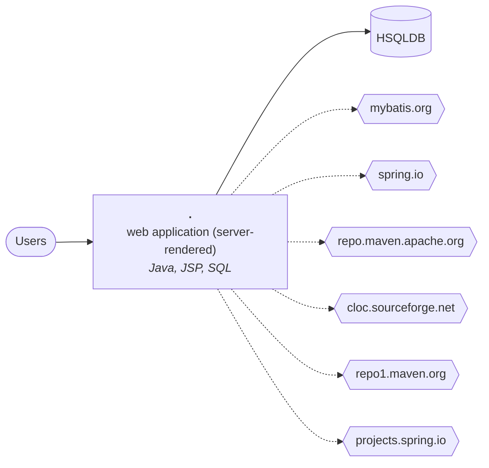

# Technical report: jpetstore-6

Generated by Software Archaeology 2.0.0 on 2026-11-10 · commit `c3dbf6f56f` · analysis: deterministic tools only (no AI)

Every finding cites the code it is based on. ✅ marks facts produced by tools; 🤖 marks AI inferences that passed the citation check but deserve a second look.

## Summary

| Severity | Findings |
|---|---|
| 🔴 critical | 1 |
| 🟠 high | 2 |
| 🟡 medium | 3 |

## Inventory

- **Size:** 8,574 lines of code in 163 files (small).
- **History:** 1488 commits by 22 contributors, 2010-12-27 → 2026-11-07; bus factor 2.

| Language | Files | Lines of code |
|---|---:|---:|
| Java | 46 | 6,420 |
| JSP | 20 | 1,058 |
| SQL | 3 | 452 |
| CSS | 2 | 304 |
| Batch | 1 | 173 |
| HTML | 2 | 167 |

**Frameworks and platforms**

- JUnit — [`pom.xml:206`](https://github.com/mybatis/jpetstore-6/blob/c3dbf6f56f6bb0730478b0f38e16ec6dfd204b23/pom.xml#L206)
- Jakarta EE — [`pom.xml:155`](https://github.com/mybatis/jpetstore-6/blob/c3dbf6f56f6bb0730478b0f38e16ec6dfd204b23/pom.xml#L155)
- MyBatis — [`pom.xml:24`](https://github.com/mybatis/jpetstore-6/blob/c3dbf6f56f6bb0730478b0f38e16ec6dfd204b23/pom.xml#L24)
- Spring — [`pom.xml:117`](https://github.com/mybatis/jpetstore-6/blob/c3dbf6f56f6bb0730478b0f38e16ec6dfd204b23/pom.xml#L117)

## Architecture (containers)

| Component | Kind | Languages | Manifests |
|---|---|---|---|
| `.` | web application (server-rendered) | Java, JSP, SQL, CSS | `pom.xml` |

## Dependencies and end of life

25 declared dependencies, 1 runtime declarations.

| Technology | Version | Cycle | End of life | Status | Declared in |
|---|---|---|---|---|---|
| Java | 11 | 11 | 2027-10-31 | supported | [`pom.xml:62`](https://github.com/mybatis/jpetstore-6/blob/c3dbf6f56f6bb0730478b0f38e16ec6dfd204b23/pom.xml#L62) |
| Spring Framework | 5.3.39 | 5.3 | 2024-08-31 | ⛔ past EOL | [`pom.xml:116`](https://github.com/mybatis/jpetstore-6/blob/c3dbf6f56f6bb0730478b0f38e16ec6dfd204b23/pom.xml#L116) |

## Hotspots (complexity × change frequency)

| File | Branches | Commits | Authors | Last change | Score |
|---|---:|---:|---:|---|---:|
| [`src/test/java/org/mybatis/jpetstore/service/OrderServiceTest.java`](https://github.com/mybatis/jpetstore-6/blob/c3dbf6f56f6bb0730478b0f38e16ec6dfd204b23/src/test/java/org/mybatis/jpetstore/service/OrderServiceTest.java) | 28 | 20 | 3 | 2026-08-16 | 1.8 |
| [`src/test/java/org/mybatis/jpetstore/service/CatalogServiceTest.java`](https://github.com/mybatis/jpetstore-6/blob/c3dbf6f56f6bb0730478b0f38e16ec6dfd204b23/src/test/java/org/mybatis/jpetstore/service/CatalogServiceTest.java) | 25 | 20 | 3 | 2026-08-15 | 1.6 |
| [`src/test/java/org/mybatis/jpetstore/service/AccountServiceTest.java`](https://github.com/mybatis/jpetstore-6/blob/c3dbf6f56f6bb0730478b0f38e16ec6dfd204b23/src/test/java/org/mybatis/jpetstore/service/AccountServiceTest.java) | 14 | 19 | 3 | 2026-08-16 | 0.8 |
| [`.mvn/wrapper/MavenWrapperDownloader.java`](https://github.com/mybatis/jpetstore-6/blob/c3dbf6f56f6bb0730478b0f38e16ec6dfd204b23/.mvn/wrapper/MavenWrapperDownloader.java) | 11 | 15 | 2 | 2026-08-09 | 0.5 |
| [`src/test/java/org/mybatis/jpetstore/ScreenTransitionIT.java`](https://github.com/mybatis/jpetstore-6/blob/c3dbf6f56f6bb0730478b0f38e16ec6dfd204b23/src/test/java/org/mybatis/jpetstore/ScreenTransitionIT.java) | 7 | 21 | 3 | 2026-08-15 | 0.5 |
| [`src/test/java/org/mybatis/jpetstore/domain/CartTest.java`](https://github.com/mybatis/jpetstore-6/blob/c3dbf6f56f6bb0730478b0f38e16ec6dfd204b23/src/test/java/org/mybatis/jpetstore/domain/CartTest.java) | 17 | 8 | 2 | 2026-08-16 | 0.4 |
| [`src/main/java/org/mybatis/jpetstore/service/OrderService.java`](https://github.com/mybatis/jpetstore-6/blob/c3dbf6f56f6bb0730478b0f38e16ec6dfd204b23/src/main/java/org/mybatis/jpetstore/service/OrderService.java) | 7 | 16 | 3 | 2026-08-15 | 0.4 |
| [`src/test/java/org/mybatis/jpetstore/web/controllers/CartControllerTest.java`](https://github.com/mybatis/jpetstore-6/blob/c3dbf6f56f6bb0730478b0f38e16ec6dfd204b23/src/test/java/org/mybatis/jpetstore/web/controllers/CartControllerTest.java) | 20 | 4 | 1 | 2026-08-16 | 0.3 |
| [`src/test/java/org/mybatis/jpetstore/mapper/AccountMapperTest.java`](https://github.com/mybatis/jpetstore-6/blob/c3dbf6f56f6bb0730478b0f38e16ec6dfd204b23/src/test/java/org/mybatis/jpetstore/mapper/AccountMapperTest.java) | 11 | 9 | 2 | 2026-08-16 | 0.3 |
| [`src/main/java/org/mybatis/jpetstore/domain/Account.java`](https://github.com/mybatis/jpetstore-6/blob/c3dbf6f56f6bb0730478b0f38e16ec6dfd204b23/src/main/java/org/mybatis/jpetstore/domain/Account.java) | 7 | 13 | 2 | 2026-08-15 | 0.3 |
| [`src/main/java/org/mybatis/jpetstore/domain/Cart.java`](https://github.com/mybatis/jpetstore-6/blob/c3dbf6f56f6bb0730478b0f38e16ec6dfd204b23/src/main/java/org/mybatis/jpetstore/domain/Cart.java) | 6 | 18 | 3 | 2026-08-15 | 0.3 |
| [`src/main/java/org/mybatis/jpetstore/service/CatalogService.java`](https://github.com/mybatis/jpetstore-6/blob/c3dbf6f56f6bb0730478b0f38e16ec6dfd204b23/src/main/java/org/mybatis/jpetstore/service/CatalogService.java) | 5 | 17 | 4 | 2026-08-15 | 0.3 |

## Entry points

Spring: 26, JSP: 20

| Framework | Method | Path | Where |
|---|---|---|---|
| Spring | REQUEST | `/account` | [`src/main/java/org/mybatis/jpetstore/web/controllers/AccountController.java:41`](https://github.com/mybatis/jpetstore-6/blob/c3dbf6f56f6bb0730478b0f38e16ec6dfd204b23/src/main/java/org/mybatis/jpetstore/web/controllers/AccountController.java#L41) |
| Spring | GET | (named by its controller) | [`src/main/java/org/mybatis/jpetstore/web/controllers/AccountController.java:69`](https://github.com/mybatis/jpetstore-6/blob/c3dbf6f56f6bb0730478b0f38e16ec6dfd204b23/src/main/java/org/mybatis/jpetstore/web/controllers/AccountController.java#L69) |
| Spring | POST | `/signon` | [`src/main/java/org/mybatis/jpetstore/web/controllers/AccountController.java:88`](https://github.com/mybatis/jpetstore-6/blob/c3dbf6f56f6bb0730478b0f38e16ec6dfd204b23/src/main/java/org/mybatis/jpetstore/web/controllers/AccountController.java#L88) |
| Spring | GET | `/signoff` | [`src/main/java/org/mybatis/jpetstore/web/controllers/AccountController.java:110`](https://github.com/mybatis/jpetstore-6/blob/c3dbf6f56f6bb0730478b0f38e16ec6dfd204b23/src/main/java/org/mybatis/jpetstore/web/controllers/AccountController.java#L110) |
| Spring | GET | `/new` | [`src/main/java/org/mybatis/jpetstore/web/controllers/AccountController.java:124`](https://github.com/mybatis/jpetstore-6/blob/c3dbf6f56f6bb0730478b0f38e16ec6dfd204b23/src/main/java/org/mybatis/jpetstore/web/controllers/AccountController.java#L124) |
| Spring | POST | `/new` | [`src/main/java/org/mybatis/jpetstore/web/controllers/AccountController.java:140`](https://github.com/mybatis/jpetstore-6/blob/c3dbf6f56f6bb0730478b0f38e16ec6dfd204b23/src/main/java/org/mybatis/jpetstore/web/controllers/AccountController.java#L140) |
| Spring | GET | `/edit` | [`src/main/java/org/mybatis/jpetstore/web/controllers/AccountController.java:156`](https://github.com/mybatis/jpetstore-6/blob/c3dbf6f56f6bb0730478b0f38e16ec6dfd204b23/src/main/java/org/mybatis/jpetstore/web/controllers/AccountController.java#L156) |
| Spring | POST | `/edit` | [`src/main/java/org/mybatis/jpetstore/web/controllers/AccountController.java:177`](https://github.com/mybatis/jpetstore-6/blob/c3dbf6f56f6bb0730478b0f38e16ec6dfd204b23/src/main/java/org/mybatis/jpetstore/web/controllers/AccountController.java#L177) |
| Spring | REQUEST | `/cart` | [`src/main/java/org/mybatis/jpetstore/web/controllers/CartController.java:39`](https://github.com/mybatis/jpetstore-6/blob/c3dbf6f56f6bb0730478b0f38e16ec6dfd204b23/src/main/java/org/mybatis/jpetstore/web/controllers/CartController.java#L39) |
| Spring | GET | (named by its controller) | [`src/main/java/org/mybatis/jpetstore/web/controllers/CartController.java:76`](https://github.com/mybatis/jpetstore-6/blob/c3dbf6f56f6bb0730478b0f38e16ec6dfd204b23/src/main/java/org/mybatis/jpetstore/web/controllers/CartController.java#L76) |
| Spring | GET | `/addItem` | [`src/main/java/org/mybatis/jpetstore/web/controllers/CartController.java:94`](https://github.com/mybatis/jpetstore-6/blob/c3dbf6f56f6bb0730478b0f38e16ec6dfd204b23/src/main/java/org/mybatis/jpetstore/web/controllers/CartController.java#L94) |
| Spring | GET | `/removeItem` | [`src/main/java/org/mybatis/jpetstore/web/controllers/CartController.java:125`](https://github.com/mybatis/jpetstore-6/blob/c3dbf6f56f6bb0730478b0f38e16ec6dfd204b23/src/main/java/org/mybatis/jpetstore/web/controllers/CartController.java#L125) |
| Spring | POST | `/update` | [`src/main/java/org/mybatis/jpetstore/web/controllers/CartController.java:154`](https://github.com/mybatis/jpetstore-6/blob/c3dbf6f56f6bb0730478b0f38e16ec6dfd204b23/src/main/java/org/mybatis/jpetstore/web/controllers/CartController.java#L154) |
| Spring | GET | `/checkout` | [`src/main/java/org/mybatis/jpetstore/web/controllers/CartController.java:185`](https://github.com/mybatis/jpetstore-6/blob/c3dbf6f56f6bb0730478b0f38e16ec6dfd204b23/src/main/java/org/mybatis/jpetstore/web/controllers/CartController.java#L185) |
| Spring | REQUEST | `/catalog` | [`src/main/java/org/mybatis/jpetstore/web/controllers/CatalogController.java:35`](https://github.com/mybatis/jpetstore-6/blob/c3dbf6f56f6bb0730478b0f38e16ec6dfd204b23/src/main/java/org/mybatis/jpetstore/web/controllers/CatalogController.java#L35) |
| Spring | GET | (named by its controller) | [`src/main/java/org/mybatis/jpetstore/web/controllers/CatalogController.java:50`](https://github.com/mybatis/jpetstore-6/blob/c3dbf6f56f6bb0730478b0f38e16ec6dfd204b23/src/main/java/org/mybatis/jpetstore/web/controllers/CatalogController.java#L50) |
| Spring | GET | `/viewCategory` | [`src/main/java/org/mybatis/jpetstore/web/controllers/CatalogController.java:65`](https://github.com/mybatis/jpetstore-6/blob/c3dbf6f56f6bb0730478b0f38e16ec6dfd204b23/src/main/java/org/mybatis/jpetstore/web/controllers/CatalogController.java#L65) |
| Spring | GET | `/viewProduct` | [`src/main/java/org/mybatis/jpetstore/web/controllers/CatalogController.java:86`](https://github.com/mybatis/jpetstore-6/blob/c3dbf6f56f6bb0730478b0f38e16ec6dfd204b23/src/main/java/org/mybatis/jpetstore/web/controllers/CatalogController.java#L86) |
| Spring | GET | `/viewItem` | [`src/main/java/org/mybatis/jpetstore/web/controllers/CatalogController.java:107`](https://github.com/mybatis/jpetstore-6/blob/c3dbf6f56f6bb0730478b0f38e16ec6dfd204b23/src/main/java/org/mybatis/jpetstore/web/controllers/CatalogController.java#L107) |
| Spring | GET | `/searchProducts` | [`src/main/java/org/mybatis/jpetstore/web/controllers/CatalogController.java:126`](https://github.com/mybatis/jpetstore-6/blob/c3dbf6f56f6bb0730478b0f38e16ec6dfd204b23/src/main/java/org/mybatis/jpetstore/web/controllers/CatalogController.java#L126) |
| Spring | REQUEST | `/order` | [`src/main/java/org/mybatis/jpetstore/web/controllers/OrderController.java:40`](https://github.com/mybatis/jpetstore-6/blob/c3dbf6f56f6bb0730478b0f38e16ec6dfd204b23/src/main/java/org/mybatis/jpetstore/web/controllers/OrderController.java#L40) |
| Spring | GET | `/list` | [`src/main/java/org/mybatis/jpetstore/web/controllers/OrderController.java:74`](https://github.com/mybatis/jpetstore-6/blob/c3dbf6f56f6bb0730478b0f38e16ec6dfd204b23/src/main/java/org/mybatis/jpetstore/web/controllers/OrderController.java#L74) |
| Spring | GET | `/new` | [`src/main/java/org/mybatis/jpetstore/web/controllers/OrderController.java:98`](https://github.com/mybatis/jpetstore-6/blob/c3dbf6f56f6bb0730478b0f38e16ec6dfd204b23/src/main/java/org/mybatis/jpetstore/web/controllers/OrderController.java#L98) |
| Spring | POST | `/new` | [`src/main/java/org/mybatis/jpetstore/web/controllers/OrderController.java:137`](https://github.com/mybatis/jpetstore-6/blob/c3dbf6f56f6bb0730478b0f38e16ec6dfd204b23/src/main/java/org/mybatis/jpetstore/web/controllers/OrderController.java#L137) |
| Spring | GET | `/view` | [`src/main/java/org/mybatis/jpetstore/web/controllers/OrderController.java:221`](https://github.com/mybatis/jpetstore-6/blob/c3dbf6f56f6bb0730478b0f38e16ec6dfd204b23/src/main/java/org/mybatis/jpetstore/web/controllers/OrderController.java#L221) |
| Spring | GET | `/` | [`src/main/java/org/mybatis/jpetstore/web/controllers/RootController.java:32`](https://github.com/mybatis/jpetstore-6/blob/c3dbf6f56f6bb0730478b0f38e16ec6dfd204b23/src/main/java/org/mybatis/jpetstore/web/controllers/RootController.java#L32) |
| JSP |  | `/src/main/webapp/WEB-INF/jsp/account/EditAccountForm.jsp` | [`src/main/webapp/WEB-INF/jsp/account/EditAccountForm.jsp`](https://github.com/mybatis/jpetstore-6/blob/c3dbf6f56f6bb0730478b0f38e16ec6dfd204b23/src/main/webapp/WEB-INF/jsp/account/EditAccountForm.jsp) |
| JSP |  | `/src/main/webapp/WEB-INF/jsp/account/IncludeAccountFields.jsp` | [`src/main/webapp/WEB-INF/jsp/account/IncludeAccountFields.jsp`](https://github.com/mybatis/jpetstore-6/blob/c3dbf6f56f6bb0730478b0f38e16ec6dfd204b23/src/main/webapp/WEB-INF/jsp/account/IncludeAccountFields.jsp) |
| JSP |  | `/src/main/webapp/WEB-INF/jsp/account/NewAccountForm.jsp` | [`src/main/webapp/WEB-INF/jsp/account/NewAccountForm.jsp`](https://github.com/mybatis/jpetstore-6/blob/c3dbf6f56f6bb0730478b0f38e16ec6dfd204b23/src/main/webapp/WEB-INF/jsp/account/NewAccountForm.jsp) |
| JSP |  | `/src/main/webapp/WEB-INF/jsp/account/SignonForm.jsp` | [`src/main/webapp/WEB-INF/jsp/account/SignonForm.jsp`](https://github.com/mybatis/jpetstore-6/blob/c3dbf6f56f6bb0730478b0f38e16ec6dfd204b23/src/main/webapp/WEB-INF/jsp/account/SignonForm.jsp) |
| JSP |  | `/src/main/webapp/WEB-INF/jsp/cart/Cart.jsp` | [`src/main/webapp/WEB-INF/jsp/cart/Cart.jsp`](https://github.com/mybatis/jpetstore-6/blob/c3dbf6f56f6bb0730478b0f38e16ec6dfd204b23/src/main/webapp/WEB-INF/jsp/cart/Cart.jsp) |
| JSP |  | `/src/main/webapp/WEB-INF/jsp/cart/Checkout.jsp` | [`src/main/webapp/WEB-INF/jsp/cart/Checkout.jsp`](https://github.com/mybatis/jpetstore-6/blob/c3dbf6f56f6bb0730478b0f38e16ec6dfd204b23/src/main/webapp/WEB-INF/jsp/cart/Checkout.jsp) |
| JSP |  | `/src/main/webapp/WEB-INF/jsp/cart/IncludeMyList.jsp` | [`src/main/webapp/WEB-INF/jsp/cart/IncludeMyList.jsp`](https://github.com/mybatis/jpetstore-6/blob/c3dbf6f56f6bb0730478b0f38e16ec6dfd204b23/src/main/webapp/WEB-INF/jsp/cart/IncludeMyList.jsp) |
| JSP |  | `/src/main/webapp/WEB-INF/jsp/catalog/Category.jsp` | [`src/main/webapp/WEB-INF/jsp/catalog/Category.jsp`](https://github.com/mybatis/jpetstore-6/blob/c3dbf6f56f6bb0730478b0f38e16ec6dfd204b23/src/main/webapp/WEB-INF/jsp/catalog/Category.jsp) |
| JSP |  | `/src/main/webapp/WEB-INF/jsp/catalog/Item.jsp` | [`src/main/webapp/WEB-INF/jsp/catalog/Item.jsp`](https://github.com/mybatis/jpetstore-6/blob/c3dbf6f56f6bb0730478b0f38e16ec6dfd204b23/src/main/webapp/WEB-INF/jsp/catalog/Item.jsp) |
| JSP |  | `/src/main/webapp/WEB-INF/jsp/catalog/Main.jsp` | [`src/main/webapp/WEB-INF/jsp/catalog/Main.jsp`](https://github.com/mybatis/jpetstore-6/blob/c3dbf6f56f6bb0730478b0f38e16ec6dfd204b23/src/main/webapp/WEB-INF/jsp/catalog/Main.jsp) |
| JSP |  | `/src/main/webapp/WEB-INF/jsp/catalog/Product.jsp` | [`src/main/webapp/WEB-INF/jsp/catalog/Product.jsp`](https://github.com/mybatis/jpetstore-6/blob/c3dbf6f56f6bb0730478b0f38e16ec6dfd204b23/src/main/webapp/WEB-INF/jsp/catalog/Product.jsp) |
| JSP |  | `/src/main/webapp/WEB-INF/jsp/catalog/SearchProducts.jsp` | [`src/main/webapp/WEB-INF/jsp/catalog/SearchProducts.jsp`](https://github.com/mybatis/jpetstore-6/blob/c3dbf6f56f6bb0730478b0f38e16ec6dfd204b23/src/main/webapp/WEB-INF/jsp/catalog/SearchProducts.jsp) |
| JSP |  | `/src/main/webapp/WEB-INF/jsp/common/Error.jsp` | [`src/main/webapp/WEB-INF/jsp/common/Error.jsp`](https://github.com/mybatis/jpetstore-6/blob/c3dbf6f56f6bb0730478b0f38e16ec6dfd204b23/src/main/webapp/WEB-INF/jsp/common/Error.jsp) |
| JSP |  | `/src/main/webapp/WEB-INF/jsp/common/IncludeBottom.jsp` | [`src/main/webapp/WEB-INF/jsp/common/IncludeBottom.jsp`](https://github.com/mybatis/jpetstore-6/blob/c3dbf6f56f6bb0730478b0f38e16ec6dfd204b23/src/main/webapp/WEB-INF/jsp/common/IncludeBottom.jsp) |

…and 6 more in `evidence/api.json`.

## Database

- **Stores referenced:** HSQLDB
- **Objects in SQL files:** table: 26
- **ORM entities / mappers:** 11

## Tests and delivery

- **Tests:** 20 files, test/source ratio 0.70, frameworks: JUnit, Selenium
- **CI:** GitHub Actions · **Containers:** 1 Dockerfile(s) · **IaC:** none · **Observability:** SLF4J

## Findings

### Dependencies

#### DEP-001 · Spring Framework 5.3.39 is past its end of life (2024-08-31)

**Severity:** 🟠 high · **Confidence:** high · **Effort:** L · ✅ verified by tools

**What it means technically.** Release cycle 5.3 of spring-framework gets no security or bug fixes since 2024-08-31. The newest cycle is 7.0.

**What it means for the business.** Part of the system runs on Spring Framework 5.3.39, which its maker stopped fixing on 2024-08-31. New security holes will stay open, and auditors and insurers usually flag this.

**Recommendation.** Plan an upgrade of Spring Framework to a supported release (7.0 or another supported cycle).

**Evidence**

- [`pom.xml:116`](https://github.com/mybatis/jpetstore-6/blob/c3dbf6f56f6bb0730478b0f38e16ec6dfd204b23/pom.xml#L116) — endoflife.date

**References:** <https://endoflife.date/spring-framework>

#### DEP-002 · Java 11 reaches end of life on 2027-10-31

**Severity:** 🟡 medium · **Confidence:** high · **Effort:** M · ✅ verified by tools

**What it means technically.** Release cycle 11 of eclipse-temurin stops receiving fixes within a year.

**What it means for the business.** Within a year, Java will stop getting security fixes. Upgrading now is cheaper than in a hurry later.

**Recommendation.** Schedule the upgrade of Java before 2027-10-31.

**Evidence**

- [`pom.xml:62`](https://github.com/mybatis/jpetstore-6/blob/c3dbf6f56f6bb0730478b0f38e16ec6dfd204b23/pom.xml#L62) — endoflife.date

**References:** <https://endoflife.date/eclipse-temurin>

### Security

#### SEC-001 · spring-web 5.3.39 has 2 known vulnerabilities

**Severity:** 🔴 critical · **Confidence:** high · **Effort:** S · ✅ verified by tools

**What it means technically.** OSV lists GHSA-4gc7-5j7h-4qph, GHSA-4wrc-f8pq-fpqp for this exact version. Spring Framework DataBinder Case Sensitive Match Exception; Pivotal Spring Framework contains unsafe Java deserialization methods

**What it means for the business.** spring-web 5.3.39, a library the system depends on, has publicly known security flaws. Attackers read these lists too.

**Recommendation.** Upgrade org.springframework:spring-web to a version without these advisories and re-test the features that use it.

**Evidence**

- [`pom.xml:132`](https://github.com/mybatis/jpetstore-6/blob/c3dbf6f56f6bb0730478b0f38e16ec6dfd204b23/pom.xml#L132) — osv.dev

**References:** <https://osv.dev/vulnerability/GHSA-4gc7-5j7h-4qph>, <https://osv.dev/vulnerability/GHSA-4wrc-f8pq-fpqp>

#### SEC-002 · spring-webmvc 5.3.39 has 16 known vulnerabilities

**Severity:** 🟠 high · **Confidence:** high · **Effort:** M · ✅ verified by tools

**What it means technically.** OSV lists GHSA-3chg-m5w7-qfv5, GHSA-4773-3jfm-qmx3, GHSA-6hcq-hmm3-jj3c, GHSA-6p4f-wcwh-5vvm, GHSA-72pg-x5f8-j25j, GHSA-957g-f97v-vppc… for this exact version. Spring Framework Cross-site Scripting via JavaScriptUtils; Spring Framework Improper Path Limitation with Script View Templates

**What it means for the business.** spring-webmvc 5.3.39, a library the system depends on, has publicly known security flaws. Attackers read these lists too.

**Recommendation.** Upgrade org.springframework:spring-webmvc to a version without these advisories and re-test the features that use it.

**Evidence**

- [`pom.xml:137`](https://github.com/mybatis/jpetstore-6/blob/c3dbf6f56f6bb0730478b0f38e16ec6dfd204b23/pom.xml#L137) — osv.dev

**References:** <https://osv.dev/vulnerability/GHSA-3chg-m5w7-qfv5>, <https://osv.dev/vulnerability/GHSA-4773-3jfm-qmx3>, <https://osv.dev/vulnerability/GHSA-6hcq-hmm3-jj3c>, <https://osv.dev/vulnerability/GHSA-6p4f-wcwh-5vvm>, <https://osv.dev/vulnerability/GHSA-72pg-x5f8-j25j>

#### SEC-003 · spring-context 5.3.39 has 2 known vulnerabilities

**Severity:** 🟡 medium · **Confidence:** high · **Effort:** S · ✅ verified by tools

**What it means technically.** OSV lists GHSA-4gc7-5j7h-4qph, GHSA-4wp7-92pw-q264 for this exact version. Spring Framework DataBinder Case Sensitive Match Exception; Spring Framework DataBinder Case Sensitive Match Exception

**What it means for the business.** spring-context 5.3.39, a library the system depends on, has publicly known security flaws. Attackers read these lists too.

**Recommendation.** Upgrade org.springframework:spring-context to a version without these advisories and re-test the features that use it.

**Evidence**

- [`pom.xml:116`](https://github.com/mybatis/jpetstore-6/blob/c3dbf6f56f6bb0730478b0f38e16ec6dfd204b23/pom.xml#L116) — osv.dev

**References:** <https://osv.dev/vulnerability/GHSA-4gc7-5j7h-4qph>, <https://osv.dev/vulnerability/GHSA-4wp7-92pw-q264>

### Technical debt

#### DEBT-001 · 8 complex files change far more often than the rest

**Severity:** 🟡 medium · **Confidence:** high · **Effort:** L · ✅ verified by tools

**What it means technically.** These files combine high branching with frequent edits: the places where defects and merge conflicts concentrate.

**What it means for the business.** A small set of files absorbs most of the changes and most of the risk. Every new feature that touches them costs more and breaks more often.

**Recommendation.** Cover these files with tests first, then split them along their responsibilities before any larger migration.

**Evidence**

- [`src/test/java/org/mybatis/jpetstore/service/OrderServiceTest.java`](https://github.com/mybatis/jpetstore-6/blob/c3dbf6f56f6bb0730478b0f38e16ec6dfd204b23/src/test/java/org/mybatis/jpetstore/service/OrderServiceTest.java) — hotspot: 28 branches, 20 commits
- [`src/test/java/org/mybatis/jpetstore/service/CatalogServiceTest.java`](https://github.com/mybatis/jpetstore-6/blob/c3dbf6f56f6bb0730478b0f38e16ec6dfd204b23/src/test/java/org/mybatis/jpetstore/service/CatalogServiceTest.java) — hotspot: 25 branches, 20 commits
- [`src/test/java/org/mybatis/jpetstore/service/AccountServiceTest.java`](https://github.com/mybatis/jpetstore-6/blob/c3dbf6f56f6bb0730478b0f38e16ec6dfd204b23/src/test/java/org/mybatis/jpetstore/service/AccountServiceTest.java) — hotspot: 14 branches, 19 commits
- [`.mvn/wrapper/MavenWrapperDownloader.java`](https://github.com/mybatis/jpetstore-6/blob/c3dbf6f56f6bb0730478b0f38e16ec6dfd204b23/.mvn/wrapper/MavenWrapperDownloader.java) — hotspot: 11 branches, 15 commits
- [`src/test/java/org/mybatis/jpetstore/ScreenTransitionIT.java`](https://github.com/mybatis/jpetstore-6/blob/c3dbf6f56f6bb0730478b0f38e16ec6dfd204b23/src/test/java/org/mybatis/jpetstore/ScreenTransitionIT.java) — hotspot: 7 branches, 21 commits
- [`src/test/java/org/mybatis/jpetstore/domain/CartTest.java`](https://github.com/mybatis/jpetstore-6/blob/c3dbf6f56f6bb0730478b0f38e16ec6dfd204b23/src/test/java/org/mybatis/jpetstore/domain/CartTest.java) — hotspot: 17 branches, 8 commits
- [`src/main/java/org/mybatis/jpetstore/service/OrderService.java`](https://github.com/mybatis/jpetstore-6/blob/c3dbf6f56f6bb0730478b0f38e16ec6dfd204b23/src/main/java/org/mybatis/jpetstore/service/OrderService.java) — hotspot: 7 branches, 16 commits
- [`src/test/java/org/mybatis/jpetstore/web/controllers/CartControllerTest.java`](https://github.com/mybatis/jpetstore-6/blob/c3dbf6f56f6bb0730478b0f38e16ec6dfd204b23/src/test/java/org/mybatis/jpetstore/web/controllers/CartControllerTest.java) — hotspot: 20 branches, 4 commits

